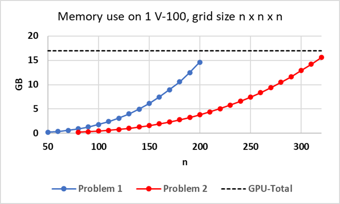
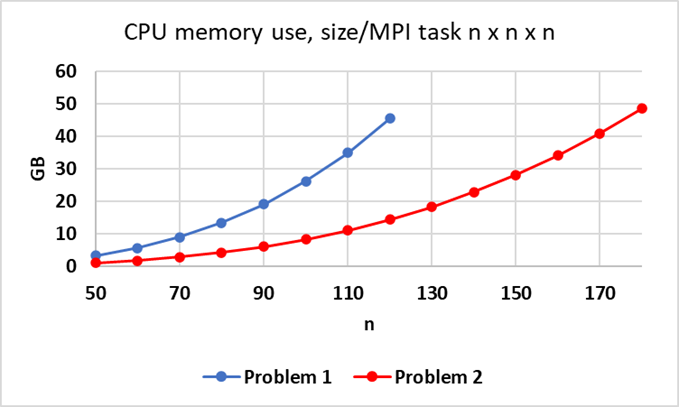
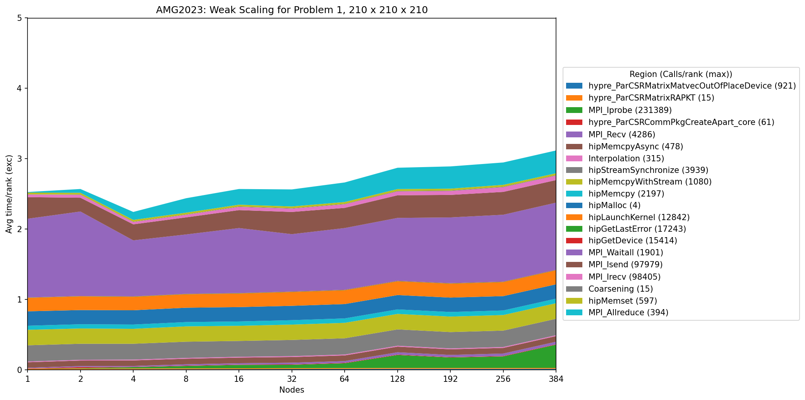
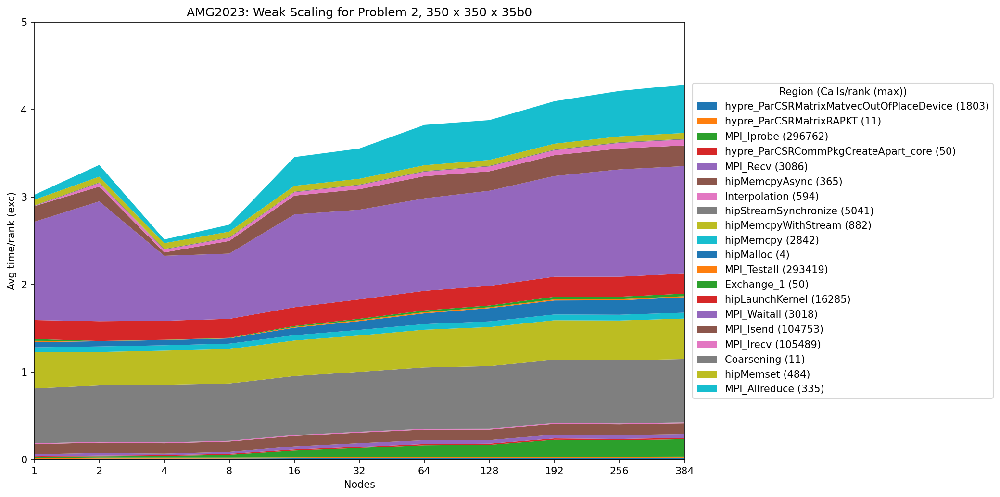

*******
AMG2023
*******

This is the documentation for Benchmark - parallel algebraic multigrid solver for 3D diffusion problems. 

Purpose
=======

The AMG2023 benchmark consists of a driver (amg.c), a simple Makefile, and documentation. It is available at https://github.com/LLNL/AMG2023 . 
It requires an installation of hypre 2.30.0 or higher. 
It uses hypre's parallel algebraic multigrid (AMG) solver BoomerAMG in combination with a Krylov solver to solve 
two linear systems arising from diffusion problems on a cuboid discretized by finite differences. 
The problems are set up through hypre's linear-algebraic IJ interface. The problem sizes can be controlled from the command line.`. 

Characteristics
===============

Problems
--------

* Problem 1 (default): The default problem is a 3D diffusion problem on a cuboid with a 27-point stencil.  It is solved with AMG-GMRES(100). 

* Problem 2 (-problem 2): This problem solves a 3D Laplace problem on a cuboid with a 7-point stencil.  It is solved with AMG-PCG using one level of aggressive coarsening. 

The problem sizes for both problems can be set by the user from the command line.

Figure of Merit
---------------

The figure of merit (FOM) is calculated using the total number of nonzeros for all system matrices and interpolation operators on all levels of AMG (NNZ), AMG setup wall clock time (Setup_time), and AMG solve phase wall clock time (Solve_time). 
Since in time dependent problems the AMG preconditioner might be used for several solves before it needs to be reevaluated, a parameter k has also been included to simulate computation of a time dependent problem that reuses the preconditioner for an average of k time steps.

The total FOM is evaluated as follows:   FOM = NNZ / (Setup_time + k * Solve_time).
The parameter k is set to 1 in Problem 1 and to 3 in Problem 2.

Source code modifications
==========================

Please see :ref:`GlobalRunRules` for general guidance on allowed modifications. 
For AMG2023, we define the following restrictions on source code modifications:

* AMG2023 uses Hypre as the solver library, available at https://github.com/hypre-space/hypre .  While source code changes to Hypre can be proposed, Hypre in AMG2023 may not be replaced with any other library.

* Solver parameters should remain unchanged (smoothers, coarsening, etc.).  AMG2023 uses the default Hypre parameters appropriate for each platform.

Building
========

The AMG2023 benchmark uses a simple Makefile system for building the driver.

It requires an installation of hypre 2.30.0 or higher, which can be downloaded from https://github.com/hypre-space/hypre via

   ``git clone -b v2.30.0 https://github.com/hypre-space/hypre.git``

Information on how to install hypre is available here: https://hypre.readthedocs.io/en/latest/ 

Depending on the machine and desired programming models, different configurations are needed.
hypre configure options can be obtained by typing

   ``./configure --help``

in hypre's src directory.

When using CPUs only, hypre generally can be installed by typing

   ``./configure;``
   ``make install``

in the src directory.

If OpenMP threading within MPI tasks is desired, it should be configured as follows:

   ``./configure --with-openmp --enable-hopscotch``

If hypre should be run on Nvidia GPUs:

   ``./configure --with-cuda`` 

or 

   ``./configure --with-cuda --with-device-memory-pool``

to use the memory pool option included with hypre.

If hypre is to be run on AMD GPUs:

.. code-block:: bash

   ./configure --with-hip --with-gpu-arch=gfx90a 
   --with-MPI-lib-dirs="${MPICH_DIR}/lib" --with-MPI-libs="mpi" 
   --with-MPI-include="${MPICH_DIR}/include" 
..

If the problem to be run is larger than 2 billion, i.e., Px*Py*Pz*nx*ny*nz is larger than 2 billion, 
where Px*Py*Pz is the total number of MPI tasks and nx*ny*nz the local problem sizeper MPI task, hypre needs to be configured with 

   ``--enable-mixed-int``

since it requires 64-bit integers for some global variables. By default, hypre uses 32-bit integers.

To build the code, first modify the 'Makefile' file appropriately, 

then type

  ``make``

Other available targets are

.. code-block:: bash

  make clean       (deletes .o files)
  make distclean   (deletes .o files, libraries, and executables)
..

Running
=======

The driver for AMG2023 is called 'amg'. Type

   ``amg -help``

to get usage information.  This prints out the following:

Usage: 

.. code-block:: bash

 amg [<options>]
 
   -problem <ID>: problem ID
       1 = solves 1 problem with AMG-PCG (default) 
       2 = solves 1 problem AMG-GMRES(100)

  -n <nx> <ny> <nz>: problem size per MPI process (default: nx=ny=nz=10)

  -P <px> <py> <pz>: processor topology (default: px=py=pz=1)

  -print       : prints the system
  -printstats  : prints preconditioning and convergence stats
  -printallstats  : prints preconditioning and convergence stats
                    including residual norms for each iteration
..

All arguments are optional.  A very important option for AMG2023 is the '-P' option. 
It specifies the MPI process topology on which to run, requiring a total of  <Px>*<Py>*<Pz> MPI processes.  

The '-n' option allows one to specify the local problem size per MPI process, leading to a global problem size of <Px>*<nx> x <Py>*<ny> x <Pz>*<nz>.

Validation
==========

The validation criteria for AMG2023 is defined as the convergence criteria for the benchmark.

Memory Usage
============

AMG2023's memory needs are somewhat complicated to describe.  They are very dependent on the type of problem solved and the options used.  When turning on the '-printstats' option, memory complexities <mc> are displayed, which are defined by the sum of non-zeroes of all matrices (both system matrices and interpolation matrices on all levels) divided by the number of non-zeroes of the original matrix, i.e., at least about <mc> times as much space is needed.  However, this does not include memory needed for communication, vectors, auxiliary computations, etc. 

The figure below provides information about approximate memory usage on 1 NVIDIA V-100 for Problem 1 (AMG-GMRES, 27pt stencil) and Problem 2 (AMG-PCG, 7pt stencil, with 1 level aggressive coarsening) for increasing problem sizes n x n x n, starting at 0.24 GB for each problem.
The black dashed line indicates the GPU memory available on 1 GPU (V-100) on Lassen. 

The second figure provides memory use on 1 node of CTS-1 (Quartz) using 4 MPI tasks with 9 OpenMP threads each for Problem 1 and Problem 2 for increasing problem size n x n x n per MPI task. 

   
   Approximate memory use for Problems 1 and 2 on V-100

   
   Approximate memory use for Problems 1 and 2 on CTS-1

Weak Scaling on El Capitan
==========================

Weak scaling performance of AMG2023 problem 1 and problem 2 on El Capitan (AMD Epyc + AMD MI300A) is provided as follows.

Problem 1
---------

For problem 1, a grid size of 210 x 210 x 210 is weak scaled on El Capitan

.. csv-table::
   :header-rows: 1
   :align: center
   :file: data/amg2023_problem1_weak_rocm.csv

.. image:: plots/amg2023_problem1_weak_rocm.png
   :align: center

Timings were captured using Caliper and are presented below.

Problem 2
---------

For problem 2, a grid size of 350 x 350 x 350 is weak scaled on El Capitan

.. csv-table::
   :header-rows: 1
   :align: center
   :file: data/amg2023_problem2_weak_rocm.csv

.. image:: plots/amg2023_problem2_weak_rocm.png
   :align: center

Timings were captured using Caliper and are presented below.

References
==========

All references are available at https://github.com/hypre-space/hypre/wiki/Publications :

Van Emden Henson and Ulrike Meier Yang, "BoomerAMG: A Parallel Algebraic Multigrid Solver and Preconditioner", Appl. Num. Math. 41 (2002), pp. 155-177. 

Hans De Sterck, Ulrike Meier Yang and Jeffrey Heys, "Reducing Complexity in Parallel Algebraic Multigrid Preconditioners", SIAM Journal on Matrix Analysis and Applications 27 (2006), pp. 1019-1039. 

Hans De Sterck, Robert D. Falgout, Josh W. Nolting and Ulrike Meier Yang, "Distance-Two Interpolation for Parallel Algebraic Multigrid", Numerical Linear Algebra with Applications 15 (2008), pp. 115-139. 

Ulrike Meier Yang, "On Long Range Interpolation Operators for Aggressive Coarsening", Numerical Linear Algebra Appl.,  17 (2010), pp. 453-472. 

Allison Baker, Rob Falgout, Tzanio Kolev, and Ulrike Yang, "Multigrid Smoothers for Ultraparallel Computing", SIAM J. Sci. Comput., 33 (2011), pp. 2864-2887. 

Rui Peng Li, Bjorn Sjogreen, Ulrike Yang, "A New Class of AMG Interpolation Methods Based on Matrix-Matrix Multiplications", SIAM Journal on Scientific Computing, 43 (2021), pp. S540-S564, https://doi.org/10.1137/20M134931X 

Rob Falgout, Rui Peng Li, Bjorn Sjogreen, Lu Wang, Ulrike Yang, "Porting hypre to Heterogeneous Computer Architectures: Strategies and Experiences", Parallel Computing, 108, (2021), a. 102840

