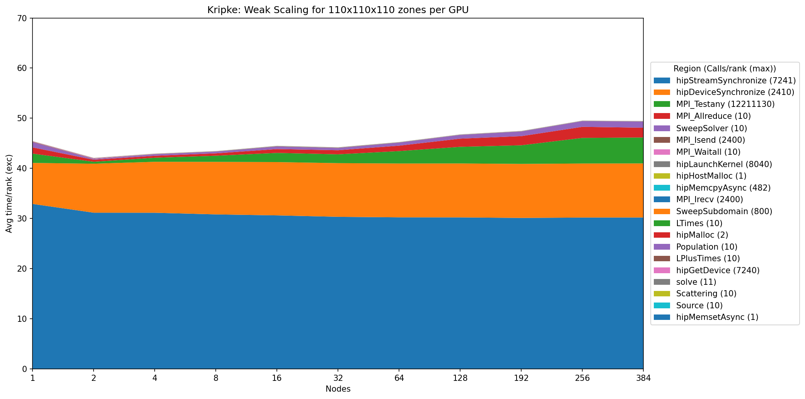

******
Kripke
******

https://github.com/LLNL/Kripke

Kripke source code is near-final at this point. The problem to run is yet to be finalized.

Purpose
=======

Kripke is a simple, scalable, 3D Sn deterministic particle transport code.
Its primary purpose is to research how data layout, programming paradigms and architectures affect the implementation and performance of Sn transport.
A main goal of Kripke is to investigate how different data-layouts affect instruction, thread, and task level parallelism, and the implications on overall solver performance.

Kripke supports storage of angular fluxes (Psi) using all six striding orders (or "nestings") of Directions (D), Groups (G), and Zones (Z), and provides computational kernels specifically written for each of these nestings.
Most Sn transport codes are designed around one of these nestings, which is an inflexibility that leads to software engineering compromises when porting to new architectures and programming paradigms.

Early research has found that the problem dimensions (zones, groups, directions, scattering order) and the scaling (number of threads and MPI tasks), can make a profound difference in the performance of each of these nestings.
To our knowledge, this is a capability unique to Kripke, and should provide key insight into how data-layout affects Sn solver performance.
An asynchronous MPI-based parallel sweep algorithm is provided, which employs the concepts of Group Sets (GS), Zone Sets (ZS), and Direction Sets (DS), borrowed from the [Texas A&M code PDT](https://multiphysics.engr.tamu.edu/research-topics/parallel-deterministic-transport/).

As we explore new architectures and programming paradigms with Kripke, we will be able to incorporate these findings and ideas into our larger codes.
The main advantages of using Kripke for this exploration is that it's light-weight (i.e. easily refactored and modified), and it gets us closer to the real question we want answered: "What is the best way to layout and traverse data in parallel in an Sn code on a given architecture+programming-model?" instead of the more commonly asked question "What is the best way to map my existing Sn code to a given architecture+programming-model?".

Characteristics
===============

Problems
--------

The problem of interest for Kripke will be run with 48 energy groups, 80 angles, and a range of zones that are TBD. The problem will be run with a GDZ loop ordering, which means the kernels will run the dimensions of the problem in the following order from the outer-most to the inner-most loop: energy groups, directions (angles), and zones.

Figure of Merit
---------------

The figure of merit will be the grind time generated from the Kripke output. It measures the amount of time required per iteration to solve each unknown.

Source code modifications
==========================

Please see :ref:`GlobalRunRules` for general guidance on allowed modifications.
For Kripke, we define the following restrictions on source code modifications:

* Kripke uses RAJA as the portability library, available at https://github.com/LLNL/RAJA . While source code changes to RAJA can be proposed, RAJA in Kripke may not be removed or replaced with any other library.

* Kripke also uses CHAI as a copy-hiding array abstraction to automatically migrate data between memory spaces. CHAI is available at https://github.com/llnl/chai .

* Kripke also uses Camp, a compiler agnostic metaprogramming library providing concepts, type operations and tuples for C++ and cuda. Available at https://github.com/llnl/camp .

* Changes cannot be made to the loop ordering defined in the problem, i.e. GDZ must stay the same. However, tiling and other loop optimizations can be made provided that the loop ordering of GDZ remains unchanged.

* Although the problem of interest requires 48 energy groups, and 80 angles, these values cannot be assumed to be constant. Compiler or code optimizations targeted at these values are not allowed.

Building
========

The easiest way to get Kripke running, is to directly invoke CMake and take whatever system defaults you have for compilers and let CMake find MPI for you.

*  Step 1:  Create a build space (assuming you are starting in the Kripke root directory)
        
        mkdir build

*  Step 2: Run CMake in that build space
        
        cd build
        cmake ..

        Load the particular compilation module suited for your system. On a system like El Capitan, load the following module:

        module load rocmcc/6.4.3-cce-20.0.2-magic

        For a number of platforms, we have CMake cache files that make things easier:

        cd build
        cmake .. -C ../host-configs/llnl-toss4-MI300A-rocm6-adams.cmake -DCMAKE_BUILD_TYPE=Release

*  Step 3: Now make Kripke:
         
        make -j8
  

Running
=======

On a system similar to El Cap (Cray system with AMD CPUs and MI300A GPUs), the following environment variables need to be set:

        export MPICH_GPU_SUPPORT_ENABLED=1
        export HSA_XNACK=1

Run Kripke with the desired problem parameters by doing:

        /path/to/kripke.exe --layout GDZ --groups 48 --quad 80

Performance Projection
======================

To project Kripke performance for a Scalable Unit (SU), scale the spatial
problem dimensions (``nxx``, ``nyy``, and ``nzz``) and the corresponding
processor decomposition (``px``, ``py``, and ``pz``) to match the size of the
SU. All other configuration options, including the number of groups, angles,
and directions, must remain unchanged. Select the spatial problem size so that
Kripke uses approximately 80% of the memory available on each node of the SU.

Use the El Capitan results in :ref:`kripke-memory-usage` to select a problem
size that meets the memory target and :ref:`kripke-weak-scaling` to project
performance at the scale of the SU.

Validation
==========

.. _kripke-memory-usage:

Memory Usage
============
Kripke uses CHAI and Umpire to manage GPU memory. During initialization, it
estimates the memory required for the selected problem size and preallocates
an Umpire device-memory pool accordingly. The ``--dev_pool_size`` runtime
parameter can be used to override the estimated pool size. Its value is an
integer number of gigabytes per rank.

When Kripke is configured with
``-DENABLE_DIRECT_UMPIRE_PLANE_STORAGE=ON``, it allocates the three plane-field
arrays (``i``, ``j``, and ``k``) directly in GPU memory instead of from the
primary Umpire pool. This optimization can improve performance for smaller problem
sizes and is disabled by default.

The output log reports the memory used by each Kripke data array, the total
memory used, and the per-rank high-water mark of the Umpire device-memory pool.
The table and figure below show Umpire memory usage for a single El Capitan
node running four ranks (px=2, py=2, pz=1).

.. csv-table::
   :header-rows: 1
   :align: center
   :file: data/kripke_memory_usage_rocm.csv

.. image:: plots/kripke_memory_usage_rocm.png
   :align: center

.. _kripke-weak-scaling:

Weak Scaling on El Capitan
==========================

Weak scaling performance of Kripke on El Capitan (AMD Epyc + AMD MI300A) is provided as follows.

.. csv-table::
   :header-rows: 1
   :align: center
   :file: data/kripke_weak_rocm.csv

.. image:: plots/kripke_weak_rocm.png
   :align: center

Timings were captured using Caliper and are presented below.

References
==========
