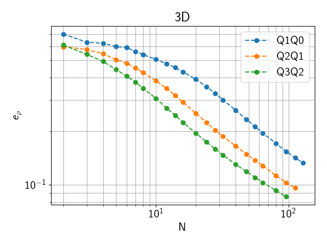
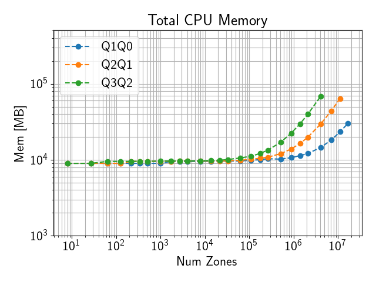
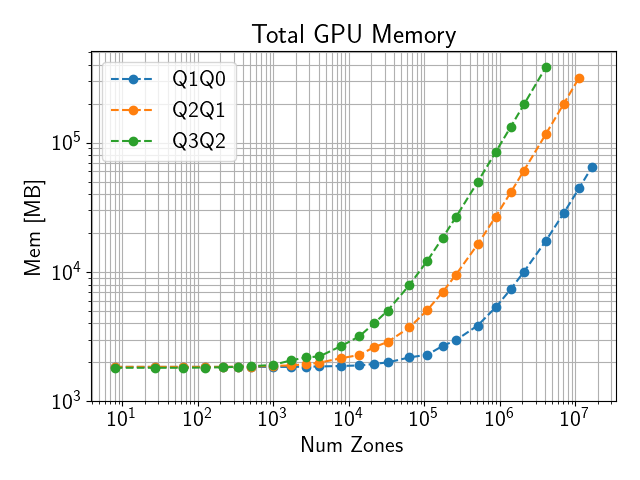
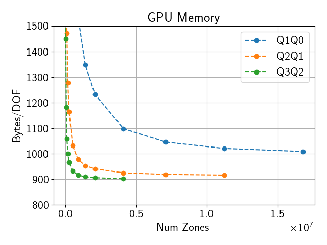
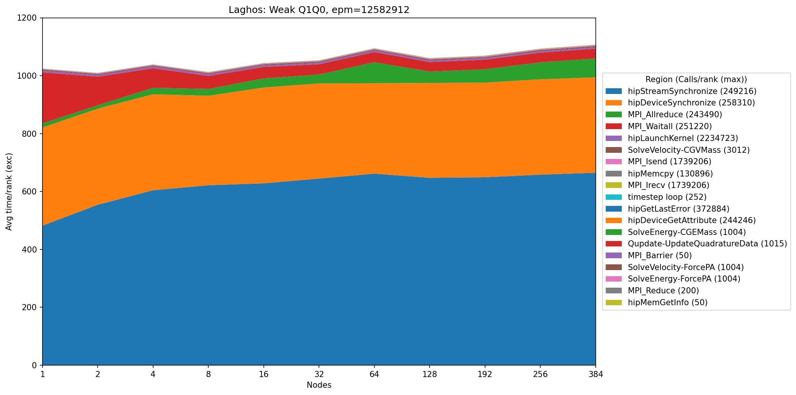
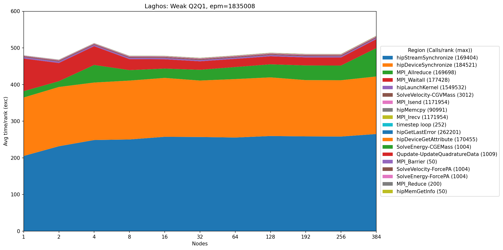
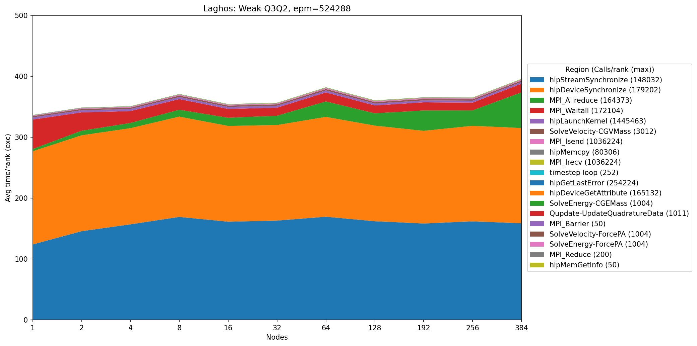

******
Laghos
******

Laghos source code is near-final at this point. The problems to run are yet to be finalized.

Purpose
=======

**Laghos** (LAGrangian High-Order Solver) is a miniapp that solves the time-dependent Euler equations of compressible gas dynamics in a moving Lagrangian frame using unstructured high-order finite element spatial discretization and explicit high-order time-stepping.
It is available at https://github.com/CEED/Laghos .

Characteristics
===============

Problems
--------

The test problems are the Sedov shock (problem 1 in Laghos) in 3D.
The test problems should be run with a conforming mesh.
Linear, quadratic, and cubic orders are of interest with the following priorities:

Priority 1 problems
^^^^^^^^^^^^^^^^^^^
   #. **3D Linear** This problem uses a kinematic order of 1, and a thermodynamic order of 0 (Q1Q0).
   #. **3D Quadratic** This problem uses a kinematic order of 2, and a thermodynamic order of 1 (Q2Q1).

Priority 2 problems
^^^^^^^^^^^^^^^^^^^
   3. **3D Cubic** This problem uses a kinematic order of 3, and a thermodynamics order of 2 (Q3Q2).

The problem sizes and partitioning scheme for both problems can be set by the user from the command line. 
The kinematic order is set using the `-ok` command-line option while the thermodynamic order is set using `-ot`. 
In all cases the default quadrature integration order should be used.
See :ref:`RunningLaghos` for how to run each of the different problems.

Figure of Merit
---------------

Each time step in Laghos contains 3 major distinct computations:

1. The inversion of the global kinematic mass matrix (CG H1).
2. The force operator evaluation from degrees of freedom to quadrature points (Forces).
3. The physics kernel in quadrature points (UpdateQuadData).

Laghos is instrumented to report the total execution times and rates, in terms of millions of degrees of freedom per second (megadofs), for each of these computational phases. (The time for inversion of the local thermodynamic mass matrices (CG L2) is also reported, but that takes a small part of the overall computation.)
Rates are averaged over all RK stages taken and for the purposes of benchmarking are configured to attempt 250 RK4 timesteps.

Laghos also reports the total rate for these major kernels, which is the **Figure of Merit (FOM)** for benchmarking purposes.

Source code modifications
=========================

.. _LaghosModifications

Please see :ref:`GlobalRunRules` for general guidance on allowed modifications.

For Laghos we define the following restrictions on source code modifications:

* Laghos must use MFEM and Hypre as the solver library, available at https://github.com/mfem/mfem and https://github.com/hypre-space/hypre respectively. Hypre must be built with ``HYPRE_ENABLE_MIXEDINT=ON``. The final validated results must match or exceed the results shown in :ref:`ValidateLaghos`.
* Laghos and MFEM must be built using RAJA, available at https://github.com/llnl/raja . Depending on system configuration RAJA can be built with "CUDA" or "HIP" device backends.
* The listed command line options for Laghos shown in :ref:`RunningLaghos` must be used without modifications. Adding the appropriate options to enable GPU execution or GPU-aware MPI is ok. Users may configure MPI to launch Laghos as desired. Example: on El Capitan in order to use GPU-aware MPI the `MPICH_GPU_SUPPORT_ENABLED` environment variable must be set.
* Hypre/MFEM/Laghos may optionally be built with Umpire (https://github.com/LLNL/Umpire). The host and device memory allocators may be changed to any available allocator in MFEM.
* `LAGHOS_DEVICE_SYNC` in `laghos_solver.cpp` must not be changed to get an accurate FOM.
* Code related to validating the Sedov solution must not be changed. These include `sedov_sol.hpp`, `sedov_sol.cpp`, `bisect.hpp`, `adaptive_quad.hpp`, and `err_order` in `laghos.cpp`. The Sedov solution must be computed using double precision regardless of the precision Laghos simulations are computed in.

Building
========

Prerequisites:

* CMake 3.24.0+
* C compiler
* C++20 compiler
* MPI

These instructions install all dependencies to a user-defined ``$INSTALLDIR`` using a user-defined ``$CC`` C compiler, ``$CXX`` C++-17 compiler, ``$CUDACC`` CUDA compiler (for CUDA acceleration), and ``$HIPCC`` HIP compiler (for HIP acceleration). Both ``nvcc`` and ``clang`` are supported as the CUDA compiler.

The minimum required version of each library are:

* Umpire: v2026.07.2
* RAJA: v2026.07.1
* Hypre: v3.2.0
* MFEM: v4.10
* Laghos: ats-6

Umpire (required)
-----------------

CUDA:

.. code-block:: console
                
                git clone --branch v2026.07.2 https://github.com/LLNL/Umpire.git
                cd Umpire
                mkdir build
                cd build
                cmake .. -DCMAKE_BUILD_TYPE=Release -DCMAKE_CUDA_ARCHITECTURES=native -DENABLE_CUDA=ON -DUMPIRE_ENABLE_C=ON -DCMAKE_INSTALL_PREFIX=$INSTALLDIR -DCMAKE_C_COMPILER=$CC -DCMAKE_CXX_COMPILER=$CXX -DCMAKE_CUDA_COMPILER=$CUDACC
                make -j install

HIP:

.. code-block:: console
                
                git clone --branch v2026.07.2 https://github.com/LLNL/Umpire.git
                cd Umpire
                mkdir build
                cd build
                cmake .. -DCMAKE_BUILD_TYPE=Release -DCMAKE_HIP_ARCHITECTURES=native -DENABLE_HIP=ON -DUMPIRE_ENABLE_C=ON -DCMAKE_INSTALL_PREFIX=$INSTALLDIR -DCMAKE_C_COMPILER=$CC -DCMAKE_CXX_COMPILER=$CXX -DCMAKE_HIP_COMPILER=$HIPCC
                make -j install

RAJA (required)
----------------

CUDA:

.. code-block:: console
                
                git clone --branch v2026.07.1 https://github.com/LLNL/RAJA.git
                cd RAJA
                mkdir build
                cd build
                cmake .. -DCMAKE_BUILD_TYPE=Release -DCMAKE_INSTALL_PREFIX=$INSTALLDIR -DRAJA_ENABLE_EXAMPLES=Off -DRAJA_ENABLE_TESTS=Off -DCMAKE_C_COMPILER=$CC -DCMAKE_CXX_COMPILER=$CXX -DCMAKE_CUDA_COMPILER=$CUDACC -DENABLE_CUDA=ON -DCMAKE_CUDA_ARCHITECTURES=native
                make -j install

HIP:

.. code-block:: console
                
                git clone --branch v2026.07.1 https://github.com/LLNL/RAJA.git
                cd RAJA
                mkdir build
                cd build
                cmake .. -DCMAKE_BUILD_TYPE=Release -DCMAKE_INSTALL_PREFIX=$INSTALLDIR -DRAJA_ENABLE_EXAMPLES=Off -DRAJA_ENABLE_TESTS=Off -DCMAKE_C_COMPILER=$CC -DCMAKE_CXX_COMPILER=$CXX -DCMAKE_HIP_COMPILER=$HIPCC -DENABLE_HIP=ON -DCMAKE_HIP_ARCHITECTURES=native -DROCPRIM_DIR=$ROCM_PATH
                make -j install

Hypre (required)
----------------

CUDA:

.. code-block:: console
                
                git clone --branch v3.2.0 https://github.com/hypre-space/hypre.git
                cd hypre/build
                cmake ../src -DCMAKE_BUILD_TYPE=Release -DHYPRE_ENABLE_MIXEDINT=ON -DCMAKE_INSTALL_PREFIX=$INSTALLDIR -DHYPRE_ENABLE_CUDA=ON -DCMAKE_CUDA_ARCHITECTURES=native -DCMAKE_C_COMPILER=$CC -DCMAKE_CXX_COMPILER=$CXX -DCMAKE_CUDA_COMPILER=$CUDACC -DHYPRE_ENABLE_GPU_AWARE_MPI=ON -DHYPRE_ENABLE_UMPIRE=ON
                make -j install

``HYPRE_ENABLE_GPU_AWARE_MPI`` and ``HYPRE_ENABLE_UMPIRE`` may be optionally turned off.

HIP:

.. code-block:: console
                
                git clone --branch v3.2.0 https://github.com/hypre-space/hypre.git
                cd hypre/build
                cmake ../src -DCMAKE_BUILD_TYPE=Release -DHYPRE_ENABLE_MIXEDINT=ON -DCMAKE_INSTALL_PREFIX=$INSTALLDIR -DHYPRE_ENABLE_HIP=ON -DCMAKE_HIP_ARCHITECTURES=native -DCMAKE_C_COMPILER=$CC -DCMAKE_CXX_COMPILER=$CXX -DCMAKE_HIP_COMPILER=$HIPCC -DHYPRE_ENABLE_GPU_AWARE_MPI=ON -DHYPRE_ENABLE_UMPIRE=ON
                make -j install

``HYPRE_ENABLE_GPU_AWARE_MPI`` and ``HYPRE_ENABLE_UMPIRE`` may be optionally turned off.

MFEM (required)
---------------

CUDA:

.. code-block:: console
                
                git clone --branch v4.10 https://github.com/mfem/mfem.git
                cd mfem
                mkdir build
                cd build
                cmake .. -DCMAKE_BUILD_TYPE=Release -DCMAKE_INSTALL_PREFIX=$INSTALLDIR -DHYPRE_DIR=$INSTALLDIR -DRAJA_DIR=$INSTALL_DIR -DMFEM_USE_MPI=ON -DMFEM_USE_CUDA=ON -DMFEM_USE_UMPIRE=ON -DMFEM_USE_RAJA=ON -DCMAKE_CUDA_ARCHITECTURES=native -DCMAKE_CXX_COMPILER=$CXX -DCMAKE_CUDA_COMPILER=$CUDACC -DUMPIRE_DIR=$INSTALLDIR -DCMAKE_CXX_STANDARD=20
                make -j install

``MFEM_USE_UMPIRE`` may be optionally turned off.

HIP:

.. code-block:: console
                
                git clone --branch v4.10 https://github.com/mfem/mfem.git
                cd mfem
                mkdir build
                cd build
                cmake .. -DCMAKE_BUILD_TYPE=Release -DCMAKE_INSTALL_PREFIX=$INSTALLDIR -DHYPRE_DIR=$INSTALLDIR -DRAJA_DIR=$INSTALL_DIR -DMFEM_USE_MPI=ON -DMFEM_USE_HIP=ON -DMFEM_USE_UMPIRE=ON -DMFEM_USE_RAJA=ON -DCMAKE_HIP_ARCHITECTURES=native -DCMAKE_CXX_COMPILER=$CXX -DCMAKE_HIP_COMPILER=$HIPCC -DUMPIRE_DIR=$INSTALLDIR -DCMAKE_CXX_STANDARD=20
                make -j install

``MFEM_USE_UMPIRE`` may be optionally turned off.

Laghos (required)
-----------------

CUDA:

.. code-block:: console
                
                git clone --branch ats-6 https://github.com/CEED/Laghos.git
                cd Laghos
                mkdir build
                cd build
                cmake .. -DCMAKE_BUILD_TYPE=Release -DCMAKE_INSTALL_PREFIX=$INSTALLDIR -DCMAKE_CXX_COMPILER=$CXX -DCMAKE_CUDA_COMPILER=$CUDACC -DCMAKE_CUDA_ARCHITECTURES=native -DCMAKE_CXX_STANDARD=20
                make -j

HIP:

.. code-block:: console
                
                git clone --branch ats-6 https://github.com/CEED/Laghos.git
                cd Laghos
                mkdir build
                cd build
                cmake .. -DCMAKE_BUILD_TYPE=Release -DCMAKE_INSTALL_PREFIX=$INSTALLDIR -DCMAKE_CXX_COMPILER=$CXX -DCMAKE_HIP_COMPILER=$HIPCC -DCMAKE_HIP_ARCHITECTURES=native -DCMAKE_CXX_STANDARD=20
                make -j

.. _RunningLaghos:

Running
=======

Benchmark runs should aim to maximize the FOM by choosing an appropriate `-epm` (element per mpi rank) value.
To ensure domains are well shaped and minimize the impact of MPI communications it is recommended to set `-epm` to either a power of 2, or something of the form `b*2^a`, where b is small and a is large.
Note that MFEM/Laghos currently does not support more than 32-bit local indexing so avoid choosing epm values which can result in more than `2^31-1` quadrature points per rank.
You can compute the number of rank local quadrature points by multiplying the epm by the number of quadrature points per zone (tabulated below).

.. table:: Quadrature points per zone.
   :align: center

   +--------+----------------+
   | Order  |  QPts per zone |
   +--------+----------------+
   | Q1Q0   |   8            |
   +--------+----------------+
   | Q2Q1   |   64           |
   +--------+----------------+
   | Q3Q2   |  216           |
   +--------+----------------+

Example run commands using `-epm` values to achieve 16 million quadrature points per rank are given below.
  
.. code-block:: console
                
                # 3D Q1Q0
                laghos -dim 3 -p 1 -ok 1 -ot 0 -oq -1 -pa -no-nc -ms 250 -tf 100000 --mem --fom -epm 524288 -d raja-gpu
                # 3D Q2Q1
                laghos -dim 3 -p 1 -ok 2 -ot 1 -oq -1 -pa -no-nc -ms 250 -tf 100000 --mem --fom -epm 65536 -d raja-gpu
                # 3D Q3Q2
                laghos -dim 3 -p 1 -ok 3 -ot 2 -oq -1 -pa -no-nc -ms 250 -tf 100000 --mem --fom -epm 19418 -d raja-gpu

Available Laghos options for configuring the GPU compute and MPI:

  * ``-dev`` for specifying which GPU to run on for a multi-GPU system (if not restricted by the job scheduler first).
  * ``-gam`` for GPU-aware MPI
  * ``-dev-pool-size`` for specifying an initial Umpire device memory pool size.

Any MPI scheduler options are allowed.
    
.. _ValidateLaghos:

Validation
==========

Code correctness is validated by using the following tests and comparing the outputted **Energy diff**, and **Density L2 error**. These quantities must be less than or equal to the following values (CPU and GPU cases should give a similar output):

.. code-block:: console

                # can be any power of 2 up to 64: [1,2,4,8,16,32,64]
                nprocs_per_side=1
                nranks=$((nprocs_per_side*nprocs_per_side*nprocs_per_side))
                epm=$((262144/nranks))
                # MPI run command can be modified as long as $nranks total ranks are used
                mpirun -n $nranks laghos -dim 3 -p 1 -ok 1 -ot 0 -oq -1 -pa -no-nc -tf 0.6 -err -epm $epm
                mpirun -n $nranks laghos -dim 3 -p 1 -ok 1 -ot 0 -oq -1 -pa -no-nc -tf 0.6 -err -d raja-gpu -epm $epm
                Energy  diff: 7.61e-05
                Density L2 error: 1.95e-01
                # MPI run command can be modified as long as $nranks total ranks are used
                mpirun -n $nranks laghos -dim 3 -p 1 -ok 2 -ot 1 -oq -1 -pa -no-nc -tf 0.6 -err -epm $epm
                mpirun -n $nranks laghos -dim 3 -p 1 -ok 2 -ot 1 -oq -1 -pa -no-nc -tf 0.6 -err -d raja-gpu -epm $epm
                Energy  diff: 3.46e-06
                Density L2 error: 1.28e-01
                # MPI run command can be modified as long as $nranks total ranks are used
                mpirun -n $nranks laghos -dim 3 -p 1 -ok 3 -ot 2 -oq -1 -pa -no-nc -tf 0.6 -err -epm $epm
                mpirun -n $nranks laghos -dim 3 -p 1 -ok 3 -ot 2 -oq -1 -pa -no-nc -tf 0.6 -err -d raja-gpu -epm $epm
                Energy  diff: 8.82e-06
                Density L2 error: 1.03e-01

The **Density L2 error** for other resolutions is shown in the following plot (for an N*N*N domain).

   **Density L2 error** for an ``NxNxN`` zone domain

Example Scalability Results
===========================

The following figure shows how well Laghos weak scales for various orders on El Capitan along with the `-epm` values used for the scaling studies.

.. figure:: plots/weak_scaling.png
   :alt: **El Capitan (MI300a)** weak scaling
   :align: center

   **El Capitan (MI300a)** weak scaling

Memory Usage
============

Total memory usage scales roughly proportional to the total number of DOFs.
Both CPU and GPU memory usage can be outputted using the ``--mem`` option.

This will output the memory usage as ``(max rank CPU mem)/(total CPU mem) MB, (max rank GPU mem)/(total GPU mem) MB``, where ``max rank CPU mem`` and ``max rank GPU mem`` are the maximum CPU and GPU memory usage of any single MPI rank respectively, while ``total CPU mem`` and ``total GPU mem`` are the total amount of CPU and GPU memory used by all ranks.

Sample CPU and GPU memory usage on a single El Capitan node are shown below.

   CPU memory use on El Capitan with 4 ranks on a single node

   GPU memory use on El Capitan with 4 ranks on a single node

   GPU memory use on El Capitan with 4 ranks on a single node per DOF

Weak Scaling on El Capitan
==========================

Weak scaling performance of Laghos on El Capitan (AMD Epyc + AMD MI300A) for each order is provided as follows.

Linear (Q1Q0)
-------------

.. csv-table::
   :header-rows: 1
   :align: center
   :file: data/laghos_linear_weak_rocm.csv

.. image:: plots/laghos_linear_weak_rocm.png
   :align: center

Timings were captured using Caliper and are presented below.

Quadratic (Q2Q1)
----------------

.. csv-table::
   :header-rows: 1
   :align: center
   :file: data/laghos_quadratic_weak_rocm.csv

.. image:: plots/laghos_quadratic_weak_rocm.png
   :align: center

Timings were captured using Caliper and are presented below.

Cubic (Q3Q2)
------------

.. csv-table::
   :header-rows: 1
   :align: center
   :file: data/laghos_cubic_weak_rocm.csv

.. image:: plots/laghos_cubic_weak_rocm.png
   :align: center

Timings were captured using Caliper and are presented below.

References
==========

.. [Laghos] V. Dobrev, Tz. Kolev and R. Rieben 'High-order curvilinear finite element methods for Lagrangian hydrodynamics', SIAM Journal on Scientific Computing, (34) 2012, pp. B606–B641. https://doi.org/10.1137/120864672
