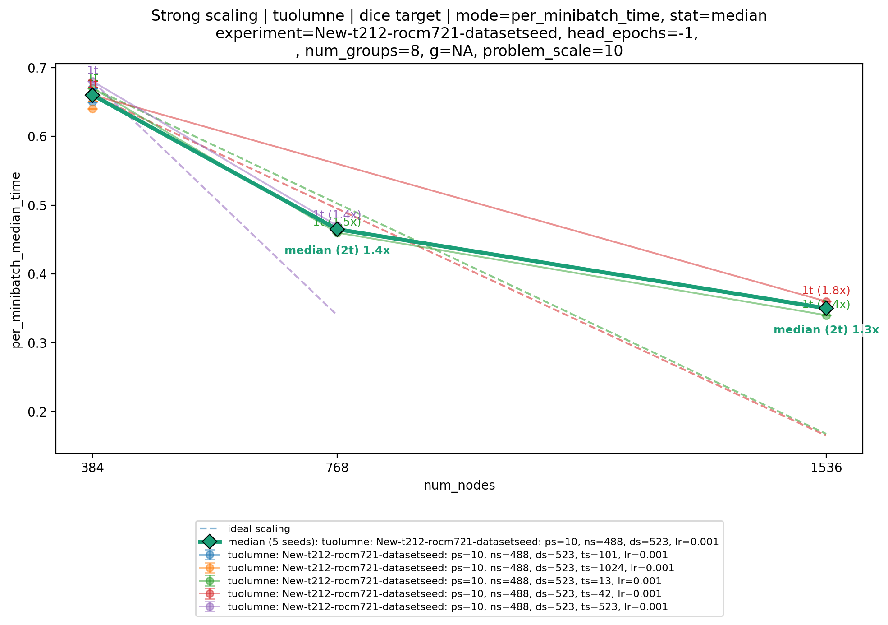
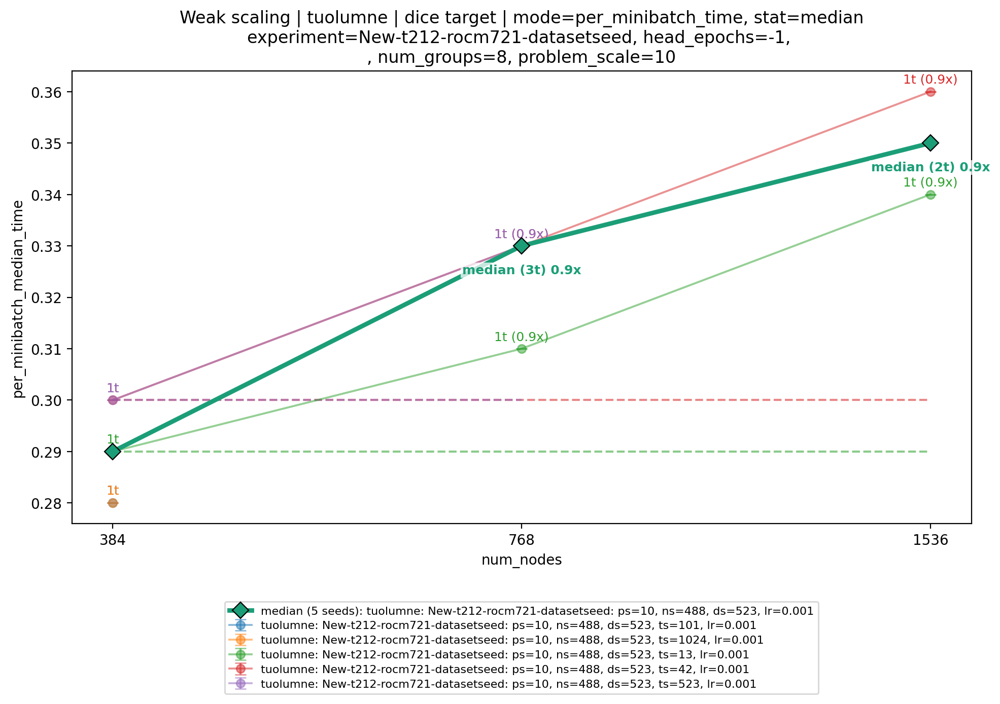

##########
 ScaFFold
##########

ScaFFold is the Scale-free Fractal benchmark for deep learning.

The ScaFFold problem description and source are near-final.

Full source code and documentation is available on `GitHub
<https://github.com/LBANN/ScaFFold>`_.

.. important::

    ScaFFold supports configurable problem sizes. This benchmark is for *one* particular
    configuration, specified in :ref:`scaffold-run-parameters` (although others may be
    useful for prototyping).

*********
 Purpose
*********

ScaFFold is a proxy application and benchmark representative of deep learning surrogate
models that are trained on large, high-resolution, three-dimensional numerical
simulations. It is meant to support benchmarking at a variety of system scales and be
adaptable to future deep learning systems innovations. ScaFFold exercises much of the
deep learning systems stack: I/O, compute, fine and coarse-grained communication, and
their integration in a framework.

*****************
 Characteristics
*****************

ScaFFold trains a 3D U-Net to perform semantic segmentation on a synthetic dataset
composed of 3D volumes containing different classes of fractals. The size of the problem
is controlled by a *scale* parameter, which varies the size and complexity of the
volumes and the depth of the U-Net. The scale parameter is exponential: each increase
roughly doubles the problem size; e.g., a scale 7 problem has a volume size of
:math:`128^3` for each sample. Using fractals enables large datasets to be generated
in-situ (rather than distributed) while ensuring a complex yet tractable semantic
segmentation problem.

The model is trained from a random initialization until convergence, which is defined to
be a validation Dice score of at least 0.95.

Problems
========

The task is a ScaFFold training problem of scale 10. See
:ref:`scaffold-run-parameters` for the required benchmark configuration.

Figure of Merit
===============

The Figure of Merit is the inverse of the accumulated epoch time needed to train the
ScaFFold model to convergence (validation Dice score of at least 0.95). Higher values
indicate better performance. Report the FOM in inverse megaseconds (1/Megaseconds).
See :ref:`scaffold-run-parameters` for the run and reporting requirements.

The FOM includes the elapsed time within each epoch through the epoch that reaches
convergence. Each interval starts before epoch setup and ends after validation metric
reduction and the learning-rate scheduler step.

.. list-table:: Work included in the FOM
    :header-rows: 1

    - - Included work
      - What it involves
    - - Epoch setup
      - Setting the training and validation sampler epochs, selecting training mode,
        and clearing gradients before processing batches.
    - - Data loading and transfers
      - Loading training and validation batches, preparing their tensors, waiting
        for data, and transferring inputs and labels to the compute devices during
        the timed epoch.
    - - Model training
      - Forward passes, loss calculation, backward passes, gradient clipping, and
        optimizer updates for all training batches, including partial batches.
    - - Validation
      - Forward passes over the validation set and calculation of validation loss
        and Dice scores, including the validation pass that establishes convergence.
    - - Distributed communication
      - Communication required by spatially sharded operations, gradient reduction,
        and aggregation of training and validation metrics during the epoch.
    - - Learning-rate scheduling
      - Updating the learning-rate scheduler after validation.
    - - Other in-epoch overhead
      - Compilation, memory allocation, logging, profiling, synchronization, and
        delays from resource contention that occur within the timed interval.

The following work occurs outside the epoch timers and is excluded from the
accumulated time used to calculate the FOM.

.. list-table:: Work excluded from the FOM
    :header-rows: 1

    - - Excluded work
      - What it involves
    - - Dataset generation
      - Creating fractal categories and instances, assembling volumes and masks,
        and writing the dataset files.
    - - Initialization
      - Starting distributed communication, constructing and placing the model,
        preparing dataloaders and the optimizer, and reading training masks to
        estimate loss weights.
    - - Warmup
      - Running training and validation batches before timed training to initialize
        kernels, compile code, tune algorithms, and prepare runtime resources.
        The model, optimizer, scheduler, and random-number state are restored
        after warmup.
    - - Between-epoch reporting
      - Collecting minibatch timing statistics, printing epoch summaries, and
        writing the training statistics CSV.
    - - Checkpointing
      - Saving model parameters, optimizer state, and other information needed to
        restart training. Checkpointing is disabled by default.
    - - Final processing
      - Generating plots, exporting profiler traces, and performing final
        synchronization and cleanup after training.

Work or delays within a timed epoch still contribute to the FOM, including data
loading, compilation, and contention from any overlapping background activity.

**Minibatch timing**

``per_minibatch_median_time`` describes the time per full training minibatch, in
seconds. Lower values indicate better performance. It measures a subset of the work
included in the FOM, as detailed below. This metric summarizes typical full-batch execution
time, while the FOM also reflects the number of epochs needed to reach convergence.

The current implementation uses PyTorch GPU events. The start event is recorded after
the dataloader supplies a batch and before its inputs and labels are transferred to
the device. The end event is recorded after the training step and per-batch metric
accumulation. Partial training batches are excluded from this timing, although they
still contribute to the FOM.

For each timed batch, ScaFFold takes the maximum duration across ranks. It then takes
the median of those durations within each epoch and the median of the epoch medians
for the run. The final value is logged as ``Median of epoch minibatch time medians``.

.. list-table:: Minibatch timing relative to the FOM categories
    :header-rows: 1

    - - FOM category
      - Included in minibatch timing
      - Omitted relative to the FOM
    - - Epoch setup
      - None.
      - Setting sampler epochs, selecting training mode, and clearing gradients
        before the batch loop.
    - - Data loading and transfers
      - Device transfers and device-side tensor preparation for the supplied
        training batch.
      - Fetching the batch from the dataloader, including file reads, worker-side
        preparation, and waits for data. All validation data loading and transfers.
    - - Model training
      - Forward passes, loss calculation, backward passes, gradient clipping,
        optimizer updates, and per-batch metric accumulation for full batches.
      - Training work for partial batches.
    - - Validation
      - None.
      - Validation forward passes, loss calculation, and Dice-score evaluation.
    - - Distributed communication
      - Communication on the timed training batch's execution path, including
        spatially sharded operations and gradient and loss reductions.
      - Epoch-level aggregation of training metrics and validation communication.
    - - Learning-rate scheduling
      - None.
      - The scheduler step after validation.
    - - Other in-epoch overhead
      - Device work and delays between the GPU events, including compilation or
        host delays that leave the device waiting within that interval.
      - Work outside the event interval, such as advancing the profiler schedule
        after the batch's end event.

***************************
 Source code modifications
***************************

See :ref:`GlobalRunRules` for general guidance on allowed modifications. For ScaFFold,
we permit the following modifications:

- In ``ScaFFold/configs/benchmark_default.yml``, any "External/user-facing" parameters
  may be changed subject to the requirements in :ref:`scaffold-run-parameters`.
- The datatypes used may be changed.

The framework constraints and required problem and learning rate specifications are
collected in :ref:`scaffold-run-parameters`.

**********
 Building
**********

See the `ScaFFold README
<https://github.com/LBANN/ScaFFold/blob/main/README.md#setup>`__ for build and setup
instructions.

For our results, we use ScaFFold version ``42d5577c1d1e775dca9dd453fd85384405c7c686`` from https://github.com/LBANN/ScaFFold.

*********
 Running
*********

See the `ScaFFold README
<https://github.com/LBANN/ScaFFold/blob/main/README.md#running-the-benchmark>`__ for
full documentation.

First, define a benchmark run configuration file using the requirements in
:ref:`scaffold-run-parameters`.

Then the synthetic dataset is generated in advance:

::

    scaffold generate_fractals -c /path/to/config.yml

Once the dataset is generated, the benchmark can be run:

::

    scaffold benchmark -c /path/to/config.yml

.. _scaffold-run-parameters:

****************
 Run Parameters
****************

All ScaFFold-specific requirements for configuring runs, performing scaling studies,
and reporting results are collected here. Start with
``ScaFFold/configs/benchmark_default.yml`` and otherwise use its default values, subject
to the source code modifications permitted above.

**Required configuration and constraints**

- Use ``problem_scale: 10`` and ``unet_bottleneck_dim: 5``.
- Use ``target_dice: 0.95``. Training is successful when the validation Dice score is
  at least 0.95.
- Use ``dataset_seed: 523`` for all reported runs.
- The training framework must be PyTorch.
- Parameters marked "Internal/dev use only" in
  ``ScaFFold/configs/benchmark_default.yml`` must not be changed.
- The training random seed (``training_seed``) must vary across the runs used to report a FOM,
  as described below; the dataset seed remains fixed at 523.

**Baseline parameters and comparability**

The following additional parameters from ``ScaFFold/configs/benchmark_default.yml``
are required for all reported results and match the baseline configuration:

- ``n_categories: 5``
- ``n_instances_used_per_fractal: 145``
- ``optimizer: "ADAM"``
- ``starting_learning_rate: 0.001``
- ``min_learning_rate: 0.0001``
- ``T_0: 10``
- ``T_mult: 2``
- ``disable_scheduler: 0``

Parameters marked "External problem specification" and "External learning rate
specification" must use the prescribed values. The exception is ``local_batch_size``,
which must follow the scaling rules below. Runs that change the prescribed problem
or learning rate settings are invalid for reporting, even if they reach the validation
Dice threshold. The benchmark logs the problem and learning rate settings alongside
the FOM.

The required configuration produces the following dataset. Volume counts refer to
logical samples before spatial sharding.

.. list-table:: Dataset for the required benchmark configuration
    :header-rows: 1

    - - Property
      - Value
    - - Logical volume dimensions
      - :math:`1024 \times 1024 \times 1024`
    - - Input channels
      - 3
    - - Foreground classes
      - 5, plus background
    - - Fractals per volume
      - 3
    - - Instances used per category
      - 144 (the generator rounds the configured value of 145 down to a multiple of 3)
    - - Total logical volumes
      - 240
    - - Training volumes
      - 168
    - - Validation volumes
      - 72 (30% of the total)

The following table gives the ``unet_bottleneck_dim`` values to use at each
``problem_scale``. The scale 10 row applies to this benchmark; other scales may be
useful for prototyping.

.. list-table::
    :header-rows: 1

    - - problem_scale
      - unet_bottleneck_dim
    - - 7
      - 3
    - - 8
      - 3
    - - 9
      - 4
    - - 10
      - 5
    - - 11
      - 6
    - - 12
      - 7

**Run preparation and FOM reporting**

- Generate the synthetic dataset before running the benchmark, using the commands in
  `Running`_.
- Measure the time in seconds to reach a validation Dice score of at least 0.95,
  including all I/O and other overheads and excluding dataset generation.
- Report the median FOM from at least three different ``training_seed`` configurations, each
  using ``dataset_seed: 523``.

**Scaling studies**

- For strong scaling, decrease ``local_batch_size`` by 2x for each 2x increase in
  resources to keep the global batch size constant. For example, use
  ``local_batch_size=1`` at 1024 ranks, ``local_batch_size=2`` at 512 ranks, and
  ``local_batch_size=4`` at 256 ranks.
- For weak scaling, use ``local_batch_size=1`` at every resource count. The
  global batch size then increases by 2x for each 2x increase in resources.
- Keep the sharding configuration constant throughout each scaling study; changing it
  affects the global batch size.

************
 Validation
************

ScaFFold reports the validation Dice score after each training epoch. The convergence
threshold required for successful training is specified in
:ref:`scaffold-run-parameters`.

*****************************
 Example Scalability Results
*****************************

**************
 Memory Usage
**************

******************************
 Strong Scaling on El Capitan
******************************

See :ref:`scaffold-run-parameters` for strong-scaling requirements.

.. image:: plots/001-strong-scaling-tuolumne-dice-target-mode-fom.png
   :align: center

.. list-table:: Strong scaling | tuolumne | dice target | mode=FOM; tuolumne; New-t212-rocm721-datasetseed: ps=10, ns=488, ds=523, lr=0.001 (FOM in 1/Megaseconds)
   :header-rows: 1

   * - num_nodes
     - training_seed
     - FOM (1/Megaseconds)
   * - 384
     - 13
     - 79.47
   * - 384
     - 42
     - 81.82
   * - 384
     - 101
     - 91.2
   * - 384
     - 523
     - 74.55
   * - 384
     - 1024
     - 82.7
   * - 768
     - 13
     - 93.93
   * - 768
     - 523
     - 131.3
   * - 1536
     - 13
     - 158.9
   * - 1536
     - 42
     - 154.5

.. list-table:: Strong scaling | tuolumne | dice target | mode=per_minibatch_time, stat=median; tuolumne; New-t212-rocm721-datasetseed: ps=10, ns=488, ds=523, lr=0.001
   :header-rows: 1

   * - num_nodes
     - seed
     - per_minibatch_median_time
   * - 384
     - 13
     - 0.67
   * - 384
     - 42
     - 0.66
   * - 384
     - 101
     - 0.65
   * - 384
     - 523
     - 0.68
   * - 384
     - 1024
     - 0.64
   * - 768
     - 13
     - 0.46
   * - 768
     - 523
     - 0.47
   * - 1536
     - 13
     - 0.34
   * - 1536
     - 42
     - 0.36

****************************
 Weak Scaling on El Capitan
****************************

See :ref:`scaffold-run-parameters` for weak-scaling requirements.

.. image:: plots/002-weak-scaling-tuolumne-dice-target-mode-fom.png
   :align: center

.. list-table:: Weak scaling | tuolumne | dice target | mode=FOM; tuolumne; New-t212-rocm721-datasetseed: ps=10, ns=488, ds=523, lr=0.001 (FOM in 1/Megaseconds)
   :header-rows: 1

   * - num_nodes
     - training_seed
     - FOM (1/Megaseconds)
   * - 384
     - 13
     - 190.1
   * - 384
     - 42
     - 182.9
   * - 384
     - 101
     - 218.8
   * - 384
     - 523
     - 166
   * - 384
     - 1024
     - 179.4
   * - 768
     - 13
     - 192
   * - 768
     - 42
     - 140.9
   * - 768
     - 523
     - 127.6
   * - 1536
     - 13
     - 158.9
   * - 1536
     - 42
     - 154.5

.. list-table:: Weak scaling | tuolumne | dice target | mode=per_minibatch_time, stat=median; tuolumne; New-t212-rocm721-datasetseed: ps=10, ns=488, ds=523, lr=0.001
   :header-rows: 1

   * - num_nodes
     - seed
     - per_minibatch_median_time
   * - 384
     - 13
     - 0.29
   * - 384
     - 42
     - 0.3
   * - 384
     - 101
     - 0.28
   * - 384
     - 523
     - 0.3
   * - 384
     - 1024
     - 0.28
   * - 768
     - 13
     - 0.31
   * - 768
     - 42
     - 0.33
   * - 768
     - 523
     - 0.33
   * - 1536
     - 13
     - 0.34
   * - 1536
     - 42
     - 0.36

************
 References
************

* LLNL ScaFFold repository: https://github.com/LBANN/ScaFFold
