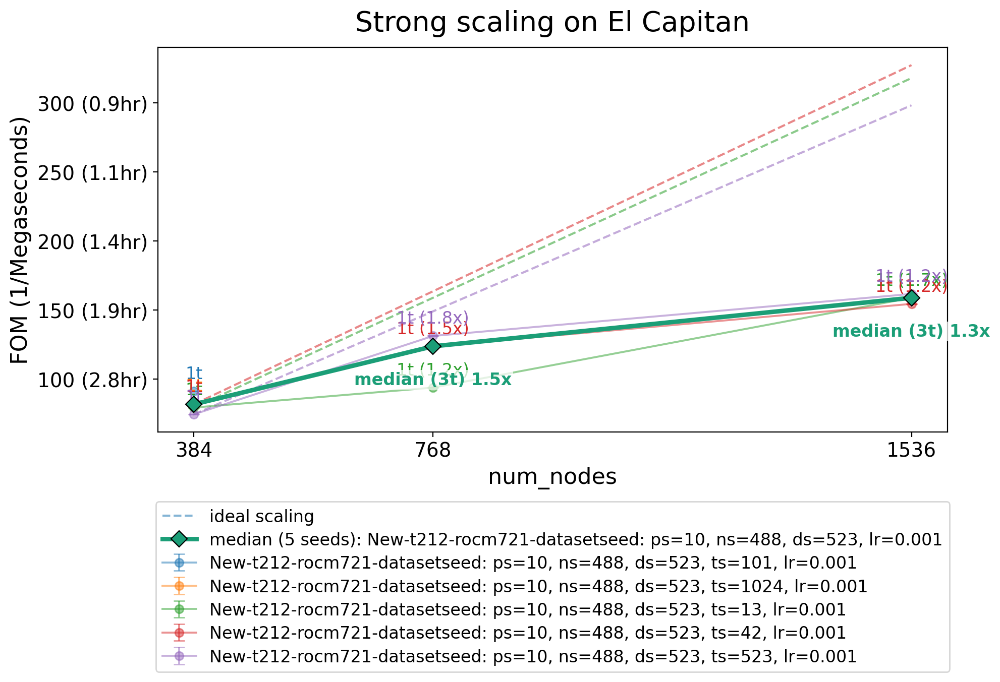
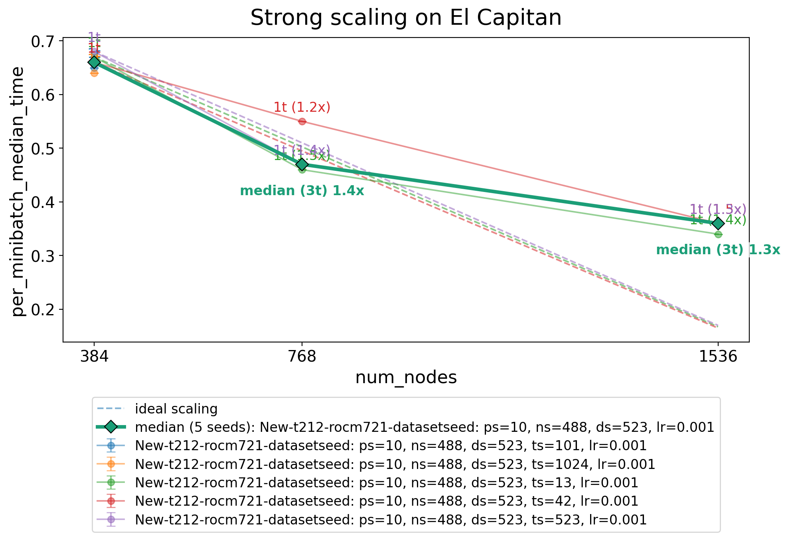
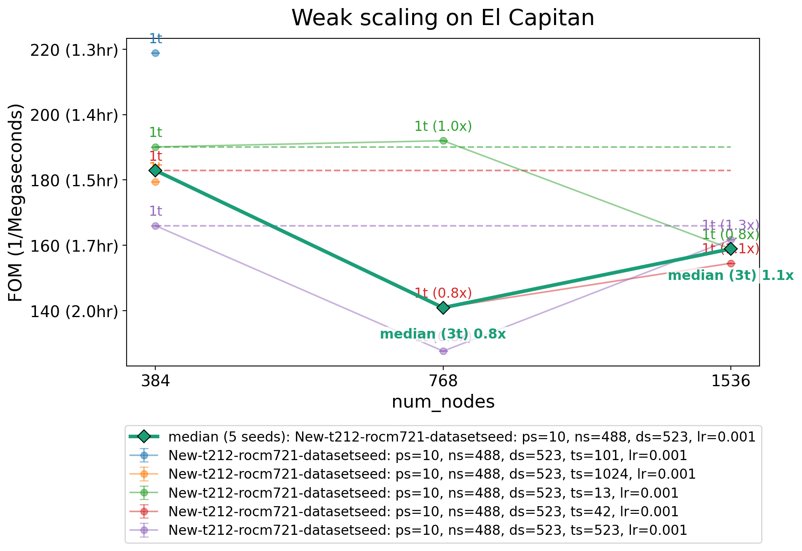
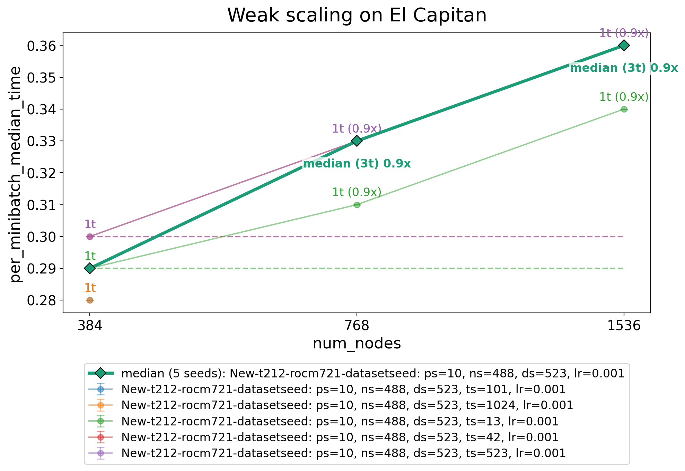

##########
 ScaFFold
##########

ScaFFold is the Scale-free Fractal benchmark for deep learning. The source code and
documentation are on `GitHub <https://github.com/LBANN/ScaFFold>`_.

The ScaFFold problem description and source are near-final.

.. important::

    ScaFFold supports a range of problem sizes, but the projections will be for one configuration,
    given in :ref:`scaffold-performance-projections`. Other sizes may be useful for
    prototyping.

*********
 Purpose
*********

ScaFFold is a proxy application and benchmark representative of deep learning surrogate
models trained on large, high-resolution, three-dimensional numerical simulations. It is
designed to support benchmarking at a range of system scales and to adapt to future
innovations in deep learning systems. ScaFFold exercises much of the deep learning
systems stack: I/O, compute, fine and coarse-grained communication, and their
integration in a framework.

*********
 Problem
*********

ScaFFold trains a 3D U-Net to perform semantic segmentation on a synthetic dataset of
3D volumes containing fractals of different classes. A *scale* parameter controls the
size and complexity of the volumes and the depth of the U-Net. Each increment doubles
the edge length of a volume; for example, a scale 7 sample is :math:`128^3` voxels.
Because the fractals are generated procedurally, large datasets can be created in situ
rather than distributed, and the segmentation problem is complex yet tractable.

The model is trained from a random initialization until it converges, which is defined
as a validation Dice score of at least 0.95.

The benchmark problem is scale 10. Volume counts below are logical samples, before
spatial sharding.

.. list-table:: Dataset for the benchmark problem
    :header-rows: 1

    - - Property
      - Value
    - - Logical volume dimensions
      - :math:`1024 \times 1024 \times 1024`
    - - Input channels
      - 3
    - - Foreground classes
      - 5, plus background
    - - Fractals per volume
      - 3
    - - Instances used per category
      - 144 (the generator rounds the configured value of 145 down to a multiple of 3)
    - - Total logical volumes
      - 240
    - - Training volumes
      - 168
    - - Validation volumes
      - 72 (30% of the total)

****************
 Figure of Merit
****************

The figure of merit (FOM) is the inverse of the total epoch time needed to train the
model to convergence (a validation Dice score of at least 0.95). Report it in inverse
megaseconds (1/Megaseconds); higher is better.

The FOM sums the timed interval of every epoch, up to and including the epoch that
reaches convergence. Each interval starts before epoch setup and ends after the
validation metrics are reduced from all ranks.

.. list-table:: Work included in the FOM
    :header-rows: 1

    - - Included work
      - What it involves
    - - Epoch setup
      - Setting the training and validation sampler epochs, selecting training mode,
        and clearing gradients before processing batches.
    - - Data loading and transfers
      - Loading training and validation batches, preparing their tensors, waiting
        for data, and transferring inputs and labels to the compute devices during
        the timed epoch.
    - - Model training
      - Forward passes, loss calculation, backward passes, gradient clipping, and
        optimizer updates for all training batches, including partial batches.
    - - Validation
      - Forward passes over the validation set and calculation of validation loss
        and Dice scores, including the validation pass that establishes convergence.
    - - Distributed communication
      - Communication required by spatially sharded operations, gradient reduction,
        and aggregation of training and validation metrics during the epoch.
    - - Learning-rate scheduling
      - Updating the learning-rate scheduler after validation.
    - - Other in-epoch overhead
      - Compilation, memory allocation, logging, profiling, synchronization, and
        delays from resource contention that occur within the timed interval.

The following work happens outside the epoch timers and does not count toward the FOM.

.. list-table:: Work excluded from the FOM
    :header-rows: 1

    - - Excluded work
      - What it involves
    - - Dataset generation
      - Creating fractal categories and instances, assembling volumes and masks,
        and writing the dataset files.
    - - Initialization
      - Starting distributed communication, constructing and placing the model,
        preparing dataloaders and the optimizer, and reading training masks to
        estimate loss weights.
    - - Warmup
      - Running training and validation batches before timed training to initialize
        kernels, compile code, tune algorithms, and prepare runtime resources.
        The model, optimizer, scheduler, and random-number state are restored
        after warmup.
    - - Between-epoch reporting
      - Collecting minibatch timing statistics, printing epoch summaries, and
        writing the training statistics CSV.
    - - Checkpointing
      - Saving model parameters, optimizer state, and other information needed to
        restart training. Checkpointing is disabled by default.
    - - Final processing
      - Generating plots, exporting profiler traces, and performing final
        synchronization and cleanup after training.

Work and delays inside a timed epoch always count toward the FOM, including data
loading, compilation, and contention from overlapping background activity.

**Minibatch timing**

``per_minibatch_median_time`` is the time, in seconds, to process one full
training minibatch; lower is better. It covers only part of the work in the FOM, as the
table below shows, and unlike the FOM it does not depend on how many epochs training
needs to converge.

ScaFFold measures ``per_minibatch_median_time`` with PyTorch GPU events. The start event is recorded after the
data loader supplies a batch and before its inputs and labels are transferred to the
device. The end event is recorded after the training step and per-batch metric
accumulation. Partial batches are excluded from this metric but still count toward the
FOM.

For each timed batch, ScaFFold takes the maximum time across ranks, then the median of
those times within each epoch, and finally the median of the epoch medians. The result
is logged as ``Median of epoch minibatch time medians``.

.. list-table:: Minibatch timing relative to the FOM categories
    :header-rows: 1

    - - FOM category
      - Included in minibatch timing
      - Omitted relative to the FOM
    - - Epoch setup
      - None.
      - Setting sampler epochs, selecting training mode, and clearing gradients
        before the batch loop.
    - - Data loading and transfers
      - Device transfers and device-side tensor preparation for the supplied
        training batch.
      - Fetching the batch from the dataloader, including file reads, worker-side
        preparation, and waits for data. All validation data loading and transfers.
    - - Model training
      - Forward passes, loss calculation, backward passes, gradient clipping,
        optimizer updates, and per-batch metric accumulation for full batches.
      - Training work for partial batches.
    - - Validation
      - None.
      - Validation forward passes, loss calculation, and Dice-score evaluation.
    - - Distributed communication
      - Communication on the timed training batch's execution path, including
        spatially sharded operations and gradient and loss reductions.
      - Epoch-level aggregation of training metrics and validation communication.
    - - Learning-rate scheduling
      - None.
      - The scheduler step after validation.
    - - Other in-epoch overhead
      - Device work and delays between the GPU events, including compilation or
        host delays that leave the device waiting within that interval.
      - Work outside the event interval, such as advancing the profiler schedule
        after the batch's end event.

***************************
 Source code modifications
***************************

See :ref:`GlobalRunRules` for general guidance on allowed modifications. For ScaFFold,
the data types may be changed, but the training framework must remain PyTorch.

**********
 Building
**********

ScaFFold is a Python package. Installing it in a virtual environment provides the
``scaffold`` executable and the ``torchrun-hpc`` launcher; see the `ScaFFold README
<https://github.com/LBANN/ScaFFold/blob/main/README.md#setup>`__ for instructions.

Example scripts for installing for CUDA and ROCm can be found in the `ScaFFold repo <https://github.com/LBANN/ScaFFold/tree/main/scripts>`__.

You must use ScaFFold commit ``42d5577c1d1e775dca9dd453fd85384405c7c686``.

*********
 Running
*********

Running ScaFFold requires a YAML configuration file. A default file is provided
``ScaFFold/configs/benchmark_default.yml`` which can be updated with the values required in
:ref:`scaffold-performance-projections`. Or values set on the CLI will override values in the YAML file.

The ScaFFold repository includes example
job scripts for running on CUDA and ROCm in the `ScaFFold repo <https://github.com/LBANN/ScaFFold/tree/main/scripts>`__. 
The `ScaFFold README
<https://github.com/LBANN/ScaFFold/blob/main/README.md#running-the-benchmark>`__ has
more detail.

First, generate the dataset using the ``generate_fractals`` subcommand for problem scale 10:

::

    scaffold generate_fractals -c config.yml --problem-scale 10

The fractals are written under ``fract_base_dir`` and can reused by later runs. Rerun this
step only if you change ``problem_scale``, ``n_categories``, or ``dataset_seed``.

Then run the benchmark. This example uses 384 nodes with four ranks per node:

::

    torchrun-hpc -N 384 -n 4 --gpus-per-proc 1 $(which scaffold) benchmark -c config.yml --problem-scale 10 --dc-num-shards 4 8 8

.. list-table::
    :header-rows: 1

    - - Argument
      - Meaning
    - - ``torchrun-hpc``
      - Launcher installed with ScaFFold. It starts the ranks through the system's
        scheduler (Flux, Slurm, or LSF) and sets up the PyTorch distributed
        environment on each one.
    - - ``-N 384``
      - Number of nodes.
    - - ``-n 4``
      - Ranks per node, normally one per GPU. The total number of ranks is the number
        of nodes times this value (1,536 here).
    - - ``--gpus-per-proc 1``
      - GPUs per rank. Each ScaFFold rank uses one GPU.
    - - ``$(which scaffold)``
      - Full path to the ``scaffold`` executable in the active Python environment.
        ``torchrun-hpc`` runs this script on every rank, so it needs the full path.
    - - ``benchmark``
      - ScaFFold subcommand that trains the model and reports the FOM.
    - - ``-c config.yml``
      - Configuration file (see :ref:`scaffold-run-parameters`).

Each ``benchmark`` command performs one run in a new timestamped directory under
``base_run_dir``. ScaFFold builds the dataset of volumes and masks under
``dataset_dir``, or reuses a matching one from an earlier run, then warms up, trains
until the validation Dice score reaches ``target_dice``, and prints the FOM. The run
directory also holds the merged configuration (``config.yaml``) and per-epoch training
statistics (``train_stats.csv``).

.. _scaffold-run-parameters:

Runtime parameters
------------------

``benchmark_default.yml`` describes each parameter in a comment and sorts them into four
groups: "External/user-facing", "External problem specification", "External learning
rate specification", and "Internal/dev use only". The rules for changing them are in
:ref:`scaffold-performance-projections`.

Set parameters in the configuration file, or override them with flags to ``scaffold
benchmark``, such as ``--training-seed 13`` or ``--local-batch-size 2``. Flags take
precedence over the file, and ``scaffold benchmark --help`` lists them all. You can also
pass ``-c`` more than once; each file overrides the ones before it.

The number of ranks and the following parameters determine how the work is divided:

``dc_num_shards`` and ``dc_shard_dims``
    Spatial parallelism with DistConv. ``dc_num_shards`` sets how many pieces each
    sample is split into along each tensor dimension listed in ``dc_shard_dims`` (by
    default, the three spatial dimensions). The ranks that share one sample form a
    data-parallel replica, so the number of replicas is the number of ranks divided by
    the product of the ``dc_num_shards`` entries.

``local_batch_size``
    Samples per training step for each replica. The global batch size is
    ``local_batch_size`` times the number of replicas, and it cannot exceed the number
    of training or validation volumes (168 and 72 for the benchmark problem). For
    example, 8 ranks with ``dc_num_shards: [1, 1, 2]`` form four replicas, and
    ``local_batch_size: 2`` gives a global batch size of 8.

``dataloader_num_workers``
    Data loader worker processes per rank. More workers use more memory.

``dataset_seed`` determines the dataset: fractal categories and instances, volume
placement, and the train/validation split. ``training_seed`` determines model
initialization and data order.

Each ``problem_scale`` has a matching ``unet_bottleneck_dim``. The benchmark uses scale
10; to prototype at other scales, use these pairs:

.. list-table::
    :header-rows: 1

    - - problem_scale
      - unet_bottleneck_dim
    - - 7
      - 3
    - - 8
      - 3
    - - 9
      - 4
    - - 10
      - 5
    - - 11
      - 6
    - - 12
      - 7

************
 Validation
************

ScaFFold reports the validation Dice score after each epoch and stops training when it
reaches ``target_dice``. A run is valid only if it reaches a validation Dice score of at
least 0.95 using the required parameters in :ref:`scaffold-performance-projections`.

**************
 Memory usage
**************

Approximate memory usage for the El Capitan baseline, with 128 GiB available per GPU.
The sharding column gives ``dc_num_shards``. The ``local_batch_size=1`` estimate
applies to both strong and weak scaling.

.. list-table:: Per-GPU memory usage
    :header-rows: 1

    - - problem_scale
      - sharding
      - local_batch_size
      - Per GPU (GiB)
    - - 10
      - [4, 8, 8]
      - 4
      - ~90
    - - 10
      - [4, 8, 8]
      - 2
      - ~50
    - - 10
      - [4, 8, 8]
      - 1
      - ~30

************************
 Baseline on El Capitan
************************

Strong scaling
--------------

The global batch size is held constant: ``local_batch_size`` halves each time the
number of nodes doubles. This data is ``local_batch_size=4`` at 384 nodes, ``local_batch_size=2`` at 768 nodes, and ``local_batch_size=1`` at 1536 nodes

.. list-table:: Strong scaling | tuolumne | dice target | mode=FOM; tuolumne; New-t212-rocm721-datasetseed: ps=10, ns=488, ds=523, lr=0.001
   :header-rows: 1

   * - num_nodes
     - seed
     - FOM (1/Megaseconds)
   * - 384
     - 13
     - 79.47
   * - 384
     - 42
     - 81.82
   * - 384
     - 101
     - 91.2
   * - 384
     - 523
     - 74.55
   * - 384
     - 1024
     - 82.7
   * - 768
     - 13
     - 93.93
   * - 768
     - 42
     - 123.8
   * - 768
     - 523
     - 131.3
   * - 1536
     - 13
     - 158.9
   * - 1536
     - 42
     - 154.5
   * - 1536
     - 523
     - 161.7

.. list-table:: Strong scaling | tuolumne | dice target | mode=per_minibatch_time, stat=median; tuolumne; New-t212-rocm721-datasetseed: ps=10, ns=488, ds=523, lr=0.001
   :header-rows: 1

   * - num_nodes
     - seed
     - per_minibatch_median_time
   * - 384
     - 13
     - 0.67
   * - 384
     - 42
     - 0.66
   * - 384
     - 101
     - 0.65
   * - 384
     - 523
     - 0.68
   * - 384
     - 1024
     - 0.64
   * - 768
     - 13
     - 0.46
   * - 768
     - 42
     - 0.55
   * - 768
     - 523
     - 0.47
   * - 1536
     - 13
     - 0.34
   * - 1536
     - 42
     - 0.36
   * - 1536
     - 523
     - 0.36

Weak scaling
------------

``local_batch_size`` is 1 at every node count, so the global batch size doubles with the
number of nodes.

.. list-table:: Weak scaling | tuolumne | dice target | mode=FOM; tuolumne; New-t212-rocm721-datasetseed: ps=10, ns=488, ds=523, lr=0.001
   :header-rows: 1

   * - num_nodes
     - seed
     - FOM (1/Megaseconds)
   * - 384
     - 13
     - 190.1
   * - 384
     - 42
     - 182.9
   * - 384
     - 101
     - 218.8
   * - 384
     - 523
     - 166
   * - 384
     - 1024
     - 179.4
   * - 768
     - 13
     - 192
   * - 768
     - 42
     - 140.9
   * - 768
     - 523
     - 127.6
   * - 1536
     - 13
     - 158.9
   * - 1536
     - 42
     - 154.5
   * - 1536
     - 523
     - 161.7

.. list-table:: Weak scaling | tuolumne | dice target | mode=per_minibatch_time, stat=median; tuolumne; New-t212-rocm721-datasetseed: ps=10, ns=488, ds=523, lr=0.001
   :header-rows: 1

   * - num_nodes
     - seed
     - per_minibatch_median_time
   * - 384
     - 13
     - 0.29
   * - 384
     - 42
     - 0.3
   * - 384
     - 101
     - 0.28
   * - 384
     - 523
     - 0.3
   * - 384
     - 1024
     - 0.28
   * - 768
     - 13
     - 0.31
   * - 768
     - 42
     - 0.33
   * - 768
     - 523
     - 0.33
   * - 1536
     - 13
     - 0.34
   * - 1536
     - 42
     - 0.36
   * - 1536
     - 523
     - 0.36

.. _scaffold-performance-projections:

*************************
 Performance projections
*************************

Project the FOM of the scale 10 problem on the proposed system for a strong-scaling
study and a weak-scaling study. Report each FOM as the median of at least three runs
with different ``training_seed`` values.

Required parameters
-------------------

Start from ``ScaFFold/configs/benchmark_default.yml`` and use the following values. Only
``problem_scale`` and ``unet_bottleneck_dim`` differ from the defaults.

.. code-block:: yaml

    problem_scale: 10
    unet_bottleneck_dim: 5
    target_dice: 0.95
    dataset_seed: 523
    n_categories: 5
    n_instances_used_per_fractal: 145
    optimizer: "ADAM"
    starting_learning_rate: 0.001
    min_learning_rate: 0.0001
    T_0: 10
    T_mult: 2
    disable_scheduler: 0

These are all of the "External problem specification" and "External learning rate
specification" parameters except ``local_batch_size``, which follows the rules in
`Scaling studies`_. A run that changes any of these values is invalid, even if it
reaches the Dice target; ScaFFold prints them alongside the FOM so they can be checked.
Do not change any parameter marked "Internal/dev use only".

Scaling studies
---------------

Choose the number of nodes, ranks per node, and sharding (``dc_num_shards``) for the proposed system. Keep the sharding the same for every run in
a study, since changing it changes the global batch size. In both studies, the global
batch size cannot exceed 72, the number of validation volumes.

Strong scaling
    Keep the global batch size constant by halving ``local_batch_size`` each time the
    number of ranks doubles; for example, 4 at 256 ranks, 2 at 512 ranks, and 1 at
    1,024 ranks. With more memory per GPU, larger local batch sizes fit, so the study
    can start at a smaller rank count.

Weak scaling
    Keep ``local_batch_size`` constant, so the global batch size doubles with the
    number of ranks. The baseline uses 1; you may instead use the largest value that
    fits in memory, which is likely to perform better.

You may also change any other "External/user-facing" parameter, such as
``dataloader_num_workers``, and the data types (see `Source code modifications`_).
