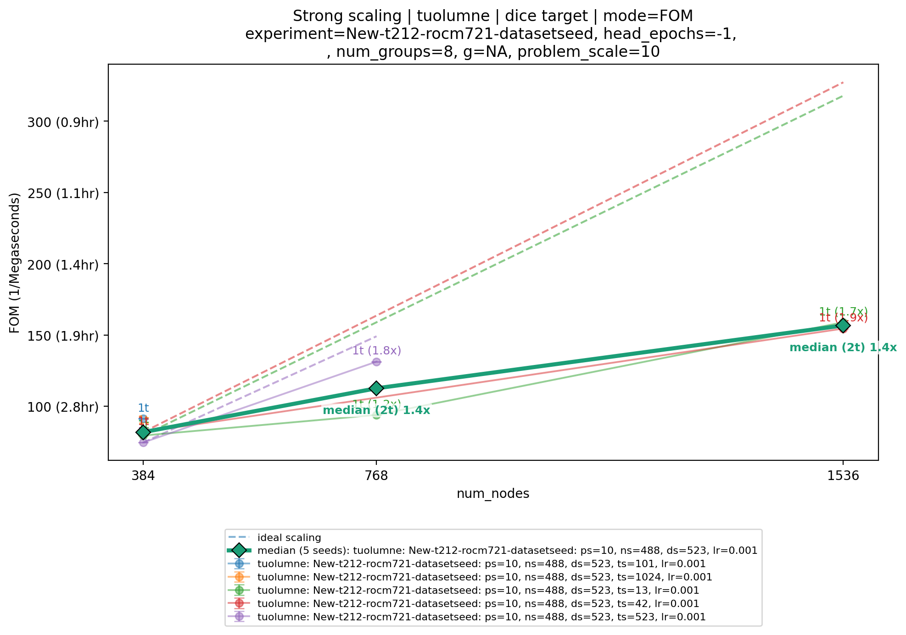
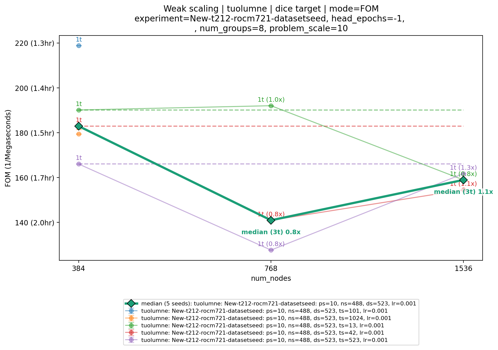

##########
 ScaFFold
##########

ScaFFold is the Scale-free Fractal benchmark for deep learning.

The ScaFFold problem description and source are near-final.

Full source code and documentation is available on `GitHub
<https://github.com/LBANN/ScaFFold>`_.

.. important::

    ScaFFold supports configurable problem sizes. This benchmark is for *one* particular
    configuration, specified in :ref:`scaffold-run-parameters` (although others may be
    useful for prototyping).

*********
 Purpose
*********

ScaFFold is a proxy application and benchmark representative of deep learning surrogate
models that are trained on large, high-resolution, three-dimensional numerical
simulations. It is meant to support benchmarking at a variety of system scales and be
adaptable to future deep learning systems innovations. ScaFFold exercises much of the
deep learning systems stack: I/O, compute, fine and coarse-grained communication, and
their integration in a framework.

*****************
 Characteristics
*****************

ScaFFold trains a 3D U-Net to perform semantic segmentation on a synthetic dataset
composed of 3D volumes containing different classes of fractals. The size of the problem
is controlled by a *scale* parameter, which varies the size and complexity of the
volumes and the depth of the U-Net. The scale parameter is exponential: each increase
roughly doubles the problem size; e.g., a scale 7 problem has a volume size of
:math:`128^3` for each sample. Using fractals enables large datasets to be generated
in-situ (rather than distributed) while ensuring a complex yet tractable semantic
segmentation problem.

The model is trained from a random initialization until convergence, which is defined to
be a validation Dice score of at least 0.95.

Problems
========

The task is a ScaFFold training problem of scale 10. See
:ref:`scaffold-run-parameters` for the required benchmark configuration.

Figure of Merit
===============

The Figure of Merit is the time (in seconds) to train the ScaFFold model to convergence
(validation Dice score of at least 0.95), inclusive of all I/O and other overheads (but
excluding dataset generation). See :ref:`scaffold-run-parameters` for the FOM
comparability and reporting requirements.

***************************
 Source code modifications
***************************

See :ref:`GlobalRunRules` for general guidance on allowed modifications. For ScaFFold,
we permit the following modifications:

- In ``ScaFFold/configs/benchmark_default.yml``, any "External/user-facing" parameters
  may be changed subject to the requirements in :ref:`scaffold-run-parameters`.
- The datatypes used may be changed.

The framework and configuration constraints, including the effect of changes to problem
and learning rate specifications on FOM comparability, are collected in
:ref:`scaffold-run-parameters`.

**********
 Building
**********

See the `ScaFFold README
<https://github.com/LBANN/ScaFFold/blob/main/README.md#setup>`__ for build and setup
instructions.

For our results, we use ScaFFold version ``42d5577c1d1e775dca9dd453fd85384405c7c686`` from https://github.com/LBANN/ScaFFold.

*********
 Running
*********

See the `ScaFFold README
<https://github.com/LBANN/ScaFFold/blob/main/README.md#running-the-benchmark>`__ for
full documentation.

First, define a benchmark run configuration file using the requirements in
:ref:`scaffold-run-parameters`.

Then the synthetic dataset is generated in advance:

::

    scaffold generate_fractals -c /path/to/config.yml

Once the dataset is generated, the benchmark can be run:

::

    scaffold benchmark -c /path/to/config.yml

.. _scaffold-run-parameters:

****************
 Run Parameters
****************

All ScaFFold-specific requirements for configuring runs, performing scaling studies,
and reporting results are collected here. Start with
``ScaFFold/configs/benchmark_default.yml`` and otherwise use its default values, subject
to the source code modifications permitted above.

**Required configuration and constraints**

- Use ``problem_scale: 10`` and ``unet_bottleneck_dim: 5``.
- Use ``target_dice: 0.95``. Training is successful when the validation Dice score is
  at least 0.95.
- Use ``dataset_seed: 523`` for all reported runs.
- The training framework must be PyTorch.
- Parameters marked "Internal/dev use only" in
  ``ScaFFold/configs/benchmark_default.yml`` must not be changed.
- The training random seed (``training_seed``) must vary across the runs used to report a FOM,
  as described below; the dataset seed remains fixed at 523.

**Baseline parameters and comparability**

The baseline data uses the following additional parameters from
``ScaFFold/configs/benchmark_default.yml``:

- ``n_categories: 5``
- ``n_instances_used_per_fractal: 145``
- ``optimizer: "ADAM"``
- ``starting_learning_rate: 0.001``
- ``min_learning_rate: 0.0001``
- ``T_0: 10``
- ``T_mult: 2``
- ``disable_scheduler: 0``

Changes to parameters marked "External problem specification" and "External learning
rate specification" may affect convergence and make results incomparable to the
baseline data. The benchmark logs the current requirements for parameters that cannot
be varied for comparable FOMs directly after printing the FOM. A FOM is specific to
these problem and learning rate parameters; for example, a run at ``target_dice=0.9``
is not comparable to a run at ``target_dice=0.95``.

The following table gives the ``unet_bottleneck_dim`` values to use at each
``problem_scale``. The scale 10 row applies to this benchmark; other scales may be
useful for prototyping.

.. list-table::
    :header-rows: 1

    - - problem_scale
      - unet_bottleneck_dim
    - - 7
      - 3
    - - 8
      - 3
    - - 9
      - 4
    - - 10
      - 5
    - - 11
      - 6
    - - 12
      - 7

**Run preparation and FOM reporting**

- Generate the synthetic dataset before running the benchmark, using the commands in
  `Running`_.
- Measure the time in seconds to reach a validation Dice score of at least 0.95,
  including all I/O and other overheads and excluding dataset generation.
- Report the median FOM from at least three different ``training_seed`` configurations, each
  using ``dataset_seed: 523``.

**Scaling studies**

- For strong scaling, decrease ``local_batch_size`` by 2x for each 2x increase in
  resources to keep the global batch size constant. For example, use
  ``local_batch_size=1`` at 1024 ranks, ``local_batch_size=2`` at 512 ranks, and
  ``local_batch_size=4`` at 256 ranks.
- For weak scaling, keep ``local_batch_size`` constant as resources increase. The
  global batch size then increases by 2x for each 2x increase in resources.
- Keep the sharding configuration constant throughout each scaling study; changing it
  affects the global batch size.

************
 Validation
************

ScaFFold reports the validation Dice score after each training epoch. The convergence
threshold required for successful training is specified in
:ref:`scaffold-run-parameters`.

*****************************
 Example Scalability Results
*****************************

**************
 Memory Usage
**************

******************************
 Strong Scaling on El Capitan
******************************

See :ref:`scaffold-run-parameters` for strong-scaling requirements.

.. list-table:: Strong scaling | tuolumne | dice target | mode=FOM; tuolumne; New-t212-rocm721-datasetseed: ps=10, ns=488, ds=523, lr=0.001 (FOM in 1/Megaseconds)
   :header-rows: 1

   * - num_nodes
     - training_seed
     - FOM (1/Megaseconds)
   * - 384
     - 13
     - 79.47
   * - 384
     - 42
     - 81.82
   * - 384
     - 101
     - 91.2
   * - 384
     - 523
     - 74.55
   * - 384
     - 1024
     - 82.7
   * - 768
     - 13
     - 93.93
   * - 768
     - 523
     - 131.3
   * - 1536
     - 13
     - 158.9
   * - 1536
     - 42
     - 154.5

****************************
 Weak Scaling on El Capitan
****************************

See :ref:`scaffold-run-parameters` for weak-scaling requirements.

.. list-table:: Weak scaling | tuolumne | dice target | mode=FOM; tuolumne; New-t212-rocm721-datasetseed: ps=10, ns=488, ds=523, lr=0.001 (FOM in 1/Megaseconds)
   :header-rows: 1

   * - num_nodes
     - training_seed
     - FOM (1/Megaseconds)
   * - 384
     - 13
     - 190.1
   * - 384
     - 42
     - 182.9
   * - 384
     - 101
     - 218.8
   * - 384
     - 523
     - 166
   * - 384
     - 1024
     - 179.4
   * - 768
     - 13
     - 192
   * - 768
     - 42
     - 140.9
   * - 768
     - 523
     - 127.6
   * - 1536
     - 13
     - 158.9
   * - 1536
     - 42
     - 154.5

************
 References
************

* LLNL ScaFFold repository: https://github.com/LBANN/ScaFFold
