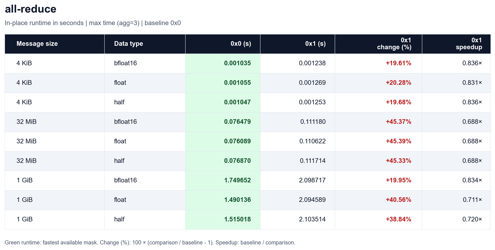
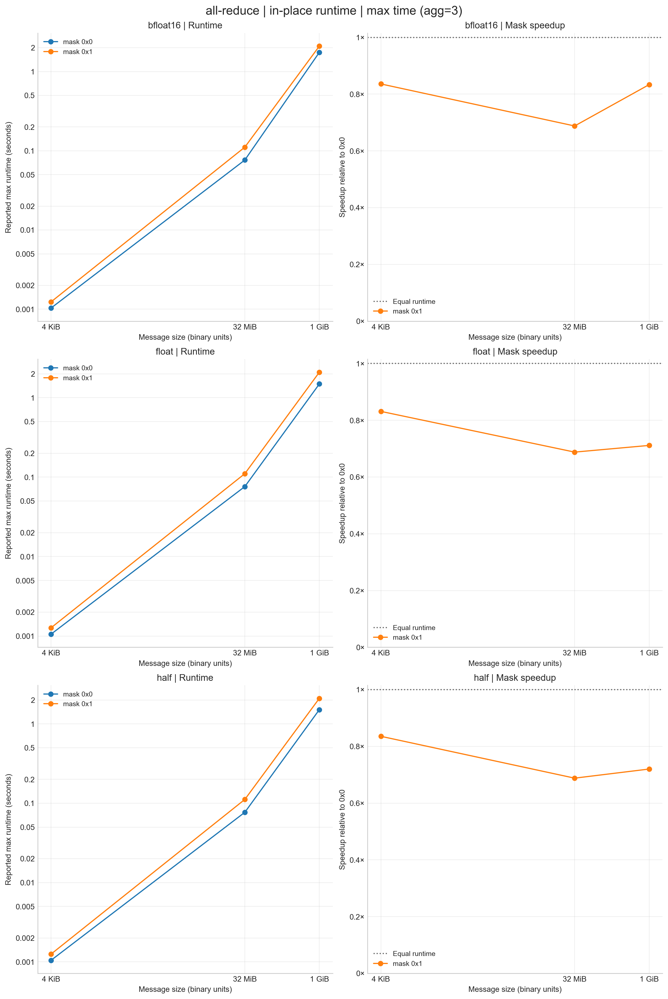
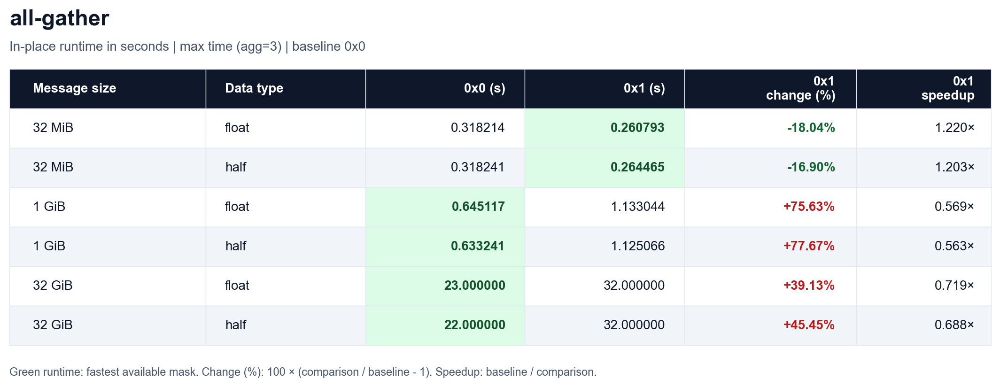
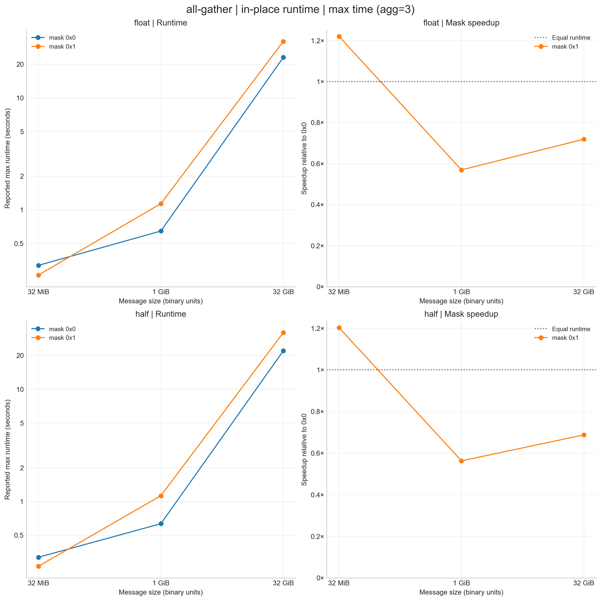
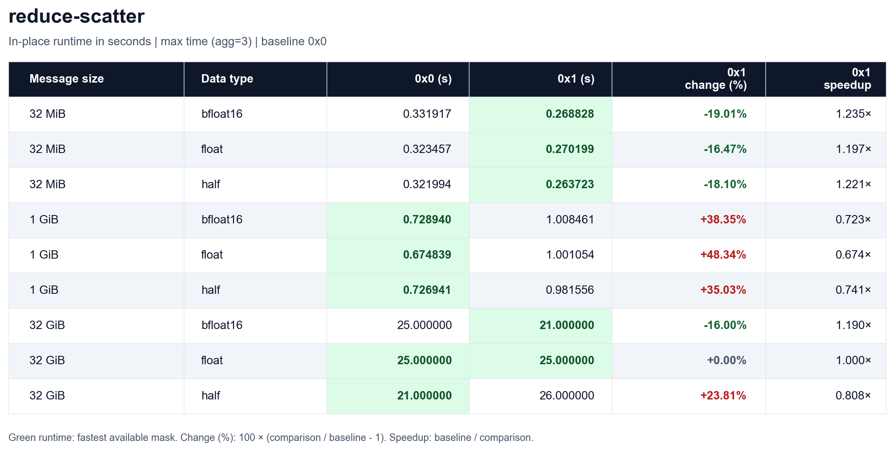
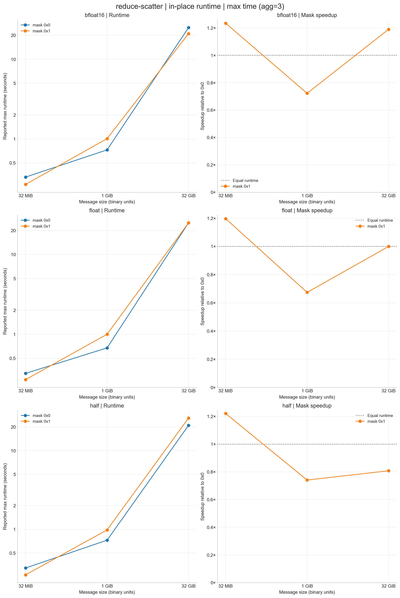
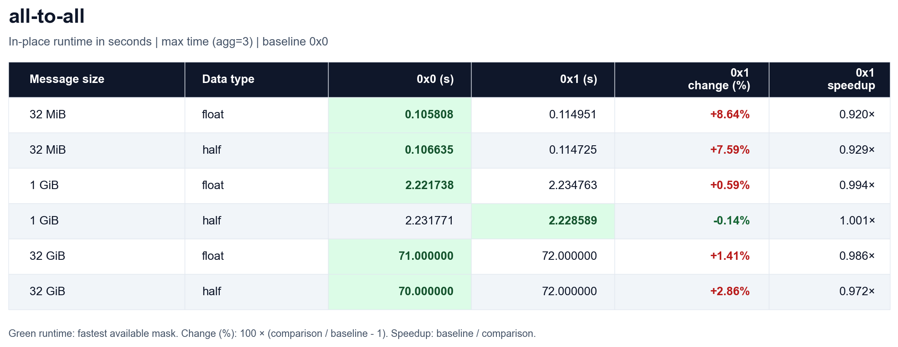
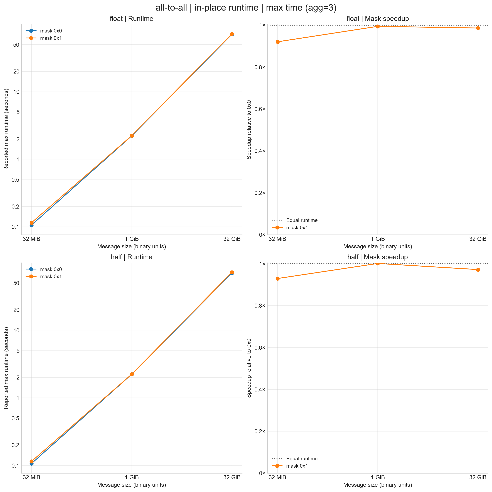

*********
CCL Tests
*********

.. note::

   Build instructions and execution commands are under development.

See :ref:`ccl-performance-projections` for the required projection coverage
and reporting details.

Purpose
=======

These benchmarks measure the worst-case latency of collective communication
operations.

Characteristics
===============

The tests cover accelerator-to-accelerator communication using RCCL Tests or
an equivalent collective communication test suite. Equivalent suites must
provide the same operation, data-type, message-size, and communicator coverage.

.. _ccl-problem:

Problem
-------

Run the following collective operations for each listed data type and message
size:

.. list-table:: Collective benchmark coverage
   :header-rows: 1
   :widths: 20 30 50

   * - Operation
     - Data types
     - Message sizes
   * - ``all_gather``
     - ``half``, ``float``
     - 32 MiB, 1 GiB, 32 GiB, Optimal
   * - ``all_reduce``
     - ``half``, ``bfloat16``, ``float``
     - 4 KiB, 32 MiB, 1 GiB, Optimal
   * - ``alltoall``
     - ``half``, ``float``
     - 32 MiB, 1 GiB, 32 GiB, Optimal
   * - ``reduce_scatter``
     - ``half``, ``bfloat16``, ``float``
     - 32 MiB, 1 GiB, 32 GiB, Optimal

Use 4 KiB only for all-reduce; omit it for all-gather, all-to-all, and
reduce-scatter because of the number of ranks at the tested scale.

The 32 GiB (``32G``) cases provide additional large-message coverage for
all-gather, all-to-all, and reduce-scatter. The supplied all-reduce results
cover 4 KiB, 32 MiB, and 1 GiB.

For the ``Optimal`` case, you may use the minimum message size that achieves
optimal bandwidth or protocol efficiency. Report the selected size. The
supplied 32 GiB results do not establish that size as optimal.

Source code modifications
=========================

Please see :ref:`GlobalRunRules` for general guidance on allowed modifications.

Building
========

Running
=======

Run every listed collective with and without partitioned communicators.
Each run must use one Scalable Unit (SU). On El Capitan, one SU is 384 nodes.
Report worst-case (maximum) latency for each
operation, data type, message size, and communicator configuration.

The RCCL results below use ``NCCL_TESTS_SPLIT_MASK=0x0`` for the unpartitioned
communicator and ``NCCL_TESTS_SPLIT_MASK=0x1`` for partitioned communicators.
See :ref:`ccl-communicator-masks` for the rank grouping used in these runs.

Scaling on El Capitan
=====================

The following tables and charts show results for one SU (384 nodes) on
El Capitan. They compare in-place runtimes for masks ``0x0`` and ``0x1``
across message sizes and data types.

Measurement configuration
-------------------------

The following settings apply to the reported measurements across all
collectives, data types, and masks.

.. list-table:: Benchmark metadata
   :header-rows: 1
   :widths: 30 70

   * - Setting
     - Value
   * - Buffer mode
     - In-place
   * - Timed iterations
     - ``n_iters >= 10`` (lower bound; exact count unspecified)
   * - Reported runtime
     - Maximum time, ``agg=3``; displayed in seconds
   * - Size step factor
     - ``stepfactor=2``

Warmup iterations depend on message size:

.. list-table:: Warmup iterations
   :header-rows: 1
   :widths: 70 30

   * - Message size
     - ``n_warmup``
   * - 4 KiB (``4K`` or ``4k``), all-reduce only
     - 100
   * - 32 MiB (``32M``)
     - 50
   * - At least 1 GiB (``>=1G``, including ``32G``)
     - 3

Warmup counts for other sizes are unspecified. The step factor describes the
benchmark configuration; the plots use only the supplied measurements. GPU
counts and hardware details are unspecified in the source metadata.

Units and plot layout
^^^^^^^^^^^^^^^^^^^^^

Message-size suffixes ``K``, ``M``, and ``G`` denote binary byte sizes. Source
timings are in microseconds; the tables and charts show seconds, calculated as
``seconds = microseconds / 1000000``.

.. _ccl-communicator-masks:

Communicator masks
^^^^^^^^^^^^^^^^^^

The mask is the value of ``NCCL_TESTS_SPLIT_MASK``:

* ``0x0`` puts all MPI ranks in one group.
* ``0x1`` splits even and odd MPI ranks into two groups that execute
  concurrently.

GPU membership depends on the MPI-rank-to-GPU mapping. These masks represent
different communicator configurations.

All-reduce
----------

   All-reduce runtime comparison by message size and data type.

   All-reduce runtime and speedup relative to mask ``0x0``.

All-gather
----------

   All-gather runtime comparison by message size and data type.

   All-gather runtime and speedup relative to mask ``0x0``.

Reduce-scatter
--------------

   Reduce-scatter runtime comparison by message size and data type.

   Reduce-scatter runtime and speedup relative to mask ``0x0``.

All-to-all
----------

   All-to-all runtime comparison by message size and data type.

   All-to-all runtime and speedup relative to mask ``0x0``.

.. _ccl-performance-projections:

Performance projections
=======================

Project the worst-case (maximum) latency on one SU of the proposed system for
each operation, data type, message size, and communicator configuration
specified below. Report latency in seconds; lower is better. The El Capitan
reference configuration is one SU comprising 384 nodes.

Required parameters
-------------------

.. list-table:: Projection coverage
   :header-rows: 1
   :widths: 30 70

   * - Parameter
     - Required coverage
   * - System scale
     - One SU of the proposed system. One SU is 384 nodes on El Capitan.
   * - Operations and data types
     - Every combination in :ref:`ccl-problem`.
   * - Message sizes
     - The sizes listed for each operation in :ref:`ccl-problem`, including
       the selected ``Optimal`` size. Use 4 KiB only for all-reduce and
       include 32 GiB for all-gather, all-to-all, and reduce-scatter.
   * - Communicators
     - Both unpartitioned and partitioned communicators. The El Capitan
       results use the configurations in :ref:`ccl-communicator-masks`.
   * - Reported metric
     - Worst-case (maximum) latency for each test case.

Reporting
---------

For each projected system configuration, report:

* The node and accelerator counts, ranks per node, total rank count, and
  rank-to-accelerator mapping.
* The communicator grouping and number of ranks per communicator.
* The hardware, system software, communication library and test-suite
  versions, build options, and execution environment.
* The buffer mode, timed iteration count, warmup count, and timing
  aggregation used for the measurements supporting the projection.
* Any source-code modifications, following :ref:`GlobalRunRules`.

Identify the measurements used to support each projection and describe the
extrapolation or estimation method and its assumptions. When using the
El Capitan results above, identify the operation, data type, message size,
and mask used for the comparison.

References
==========

* `RCCL Tests <https://github.com/ROCm/rocm-systems/tree/develop/projects/rccl-tests>`_

